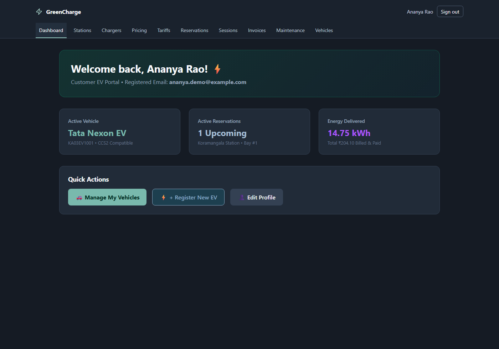
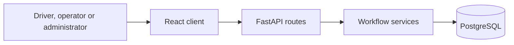

# EV Charging Network Management System

Find compatible chargers, reserve a bay, track charging, and manage billing and maintenance in one application.

[](https://github.com/EV-Charging-Network-Management-System/EV-Charging-Network-Management-System/actions/workflows/ci.yml)



React and TypeScript provide the client. FastAPI, SQLAlchemy, psycopg and PostgreSQL handle the API and transactions. The browser client uses a same-origin proxy.



## Run a seeded local demo

Generate a secret and place it in `.env` as `SECRET_KEY=<generated value>`.

```sh
python -c "import secrets; print(secrets.token_urlsafe(48))"
docker compose up --build -d
docker compose logs init
```

Open [the local app](http://127.0.0.1:8080). The init logs contain randomly generated credentials for the sample customer, operator and administrator on first initialization. Register directly in the app to try a new customer account. Compose binds the demo to loopback.

### Run without Docker

1. Create a PostgreSQL database. Set `DATABASE_URL`, `SECRET_KEY` and `SECURE_COOKIES=false` in the root `.env` for local HTTP. Use secure cookies for HTTPS.
2. From the root, install the package and migrate with `python -m pip install -e ".[dev]"` and `alembic upgrade head`.
3. For an isolated demo, run `python -m database.seed.demo --confirm-demo-database`.
4. Start the API from the root with `uvicorn backend.app.main:app --port 8000`. In another terminal, run `cd frontend`, `npm ci` and `npm run dev`.

For a database created using the original base SQL, back it up and verify that it matches the unmodified baseline before running `alembic stamp 0001_base` and `alembic upgrade head`. A previously customized database needs a migration review first. Any conflicting active bookings must be resolved before the exclusion constraint can be installed.

## Engineering decisions

- **Concurrent bookings.** PostgreSQL excludes overlapping pending or confirmed reservations for the same charger. The half-open range allows a new booking to start as the previous one ends. Tests race two independent API requests and verify the constraint directly in SQL.
- **Billing records.** Each session can have one invoice. It stores the figures used to bill the session, and each payment attempt is a separate record.
- **Authentication.** Passwords use Argon2. Access tokens expire after 15 minutes and logout revokes the token in PostgreSQL. The browser stores its token in an HttpOnly cookie and signs in again when it expires.

See [design decisions](docs/DESIGN_DECISIONS.md), [API reference](docs/API_REFERENCE.md), and [schema](docs/DATABASE_SCHEMA.md).

```text
backend/app/         API routes, services, schemas and models
backend/tests/       PostgreSQL integration and workflow tests
database/migrations/ Alembic migration history
database/schema/     Initial DDL and historical proposals
database/seed/       Sample records and demo user setup
frontend/src/        Dashboards, workflow screens and API client
docs/                Database design and usage documentation
.github/workflows/   CI configuration
```

## Verification

Set `TEST_DATABASE_URL` to a dedicated empty PostgreSQL database whose name starts with `ev_test_`. The suite resets that database's app tables.

```sh
python -m pip install -e ".[dev]"
ruff check .
mypy
python -m pytest --cov=backend.app
npm --prefix frontend ci
npm --prefix frontend run lint
npm --prefix frontend test
npm --prefix frontend run build
```

Use Conventional Commit subjects for new changes, such as `fix: reject overlapping reservations`.

## Limitations and roadmap

The manual charging workflow and simulated payments remain available. A configurable [charger simulator](docs/CHARGER_SIMULATOR.md) can start and stop a reserved session and record power and energy over OCPP 1.6J. The device integration covers a small simulator-focused subset. Session details receive live meter updates. The next releases can extend the work in three areas:

- Deploy a hosted demo, integrate Stripe test mode, and add background jobs for expiring reservations and checking charger liveness.
- Extend filtering, pagination, ownership checks, idempotency and admin auditing across the remaining workflows.
- Add station-wide live updates, richer mobile and analytics views, realistic history generation, demand forecasting, site power limits and load-test results.
