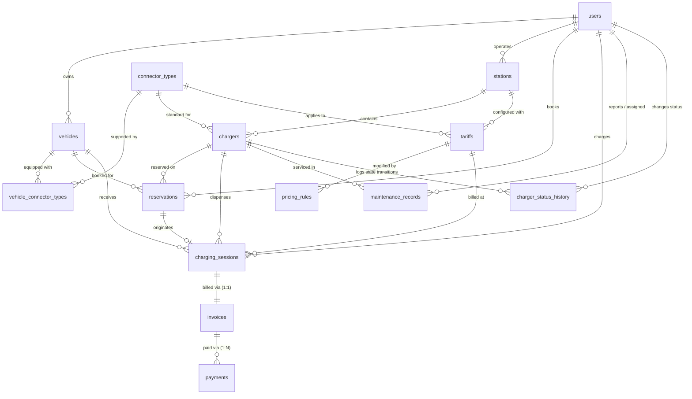

# ER Diagram vs. Physical Relational Schema Analysis

**Project:** EV Charging Network Management System  
**Database:** PostgreSQL 18 (`ev_charging_network`)  
**Date:** November 2026  
**Document Status:** Verified Against Live Database (14 Tables, 54 Dummy Records)

---

## 1. Executive Summary

This document contrasts the conceptual Entity-Relationship (ER) model of the **EV Charging Network Management System** with the implemented physical PostgreSQL 18 relational schema. The physical implementation faithfully materializes all core entities while introducing normalization (3NF/BCNF), junction tables, state constraints, and audit trails required for an enterprise-grade charging network.

---

## 2. Complete Entity-Relationship Mapping Matrix

| Conceptual Entity / Relationship | Physical Table Name | Cardinality | Key Foreign Keys | Design Implementation Details |
| :--- | :--- | :---: | :--- | :--- |
| **User** (Customer, Operator, Admin) | `users` | 1 | None | Single-table inheritance with `role IN ('CUSTOMER', 'OPERATOR', 'ADMIN')`. Unique email constraint. |
| **Connector Standard** | `connector_types` | 1 | None | Master lookup table for standards: `CCS2`, `TYPE2`, `CHADEMO`, `GB_T`. |
| **EV Registered** | `vehicles` | N:1 to `users` | `owner_user_id -> users.user_id` | Unique license registration number; battery capacity check (`> 0`). |
| **Vehicle-Connector Compatibility** | `vehicle_connector_types` | M:N | `vehicle_id -> vehicles` `connector_type_id -> connector_types` | Physical associative/junction table resolving M:N compatibility with composite PK `(vehicle_id, connector_type_id)`. |
| **Charging Station** | `stations` | N:1 to `users` (Operator) | `operator_id -> users.user_id` | Geolocation coordinates (`latitude`, `longitude`), operating hours, active status check. |
| **Charging Port / Bay** | `chargers` | N:1 to `stations` N:1 to `connector_types` | `station_id -> stations` `connector_type_id -> connector_types` | Unique per station: `UNIQUE (station_id, charger_code)`. Power capacity in kW. Operational status (`ONLINE`, `MAINTENANCE`, `OUT_OF_SERVICE`). |
| **Base Pricing / Tariff** | `tariffs` | N:1 to `stations` N:0..1 to `connector_types` | `station_id -> stations` `connector_type_id -> connector_types` | Time-bound validity (`valid_from`, `valid_to`), base per-kWh price, session connection fee, tax rate percentage. |
| **Dynamic Pricing Rule** | `pricing_rules` | N:1 to `tariffs` | `tariff_id -> tariffs.tariff_id` (ON DELETE CASCADE) | Multiplier rules: `PEAK_HOUR`, `OFF_PEAK`, `HIGH_DEMAND` with priority and demand threshold. |
| **Reservation / Slot Booking** | `reservations` | N:1 to `users` N:1 to `vehicles` N:1 to `chargers` | `user_id -> users` `vehicle_id -> vehicles` `charger_id -> chargers` | Temporal reservation window with strict `end_at > start_at` constraint. Status: `PENDING`, `CONFIRMED`, `CANCELLED`, `COMPLETED`, `NO_SHOW`. |
| **Active / Past Charging Session** | `charging_sessions` | 0..1:1 to `reservations` N:1 to `users`, `vehicles`, `chargers`, `tariffs` | `reservation_id -> reservations.reservation_id` `charger_id -> chargers` `tariff_id -> tariffs` | Handles both reserved sessions and walk-in sessions (`reservation_id` is nullable). State machine check constraint verifies meter readings and timestamps. |
| **Billing Invoice** | `invoices` | 1:1 to `charging_sessions` | `session_id -> charging_sessions.session_id` (UNIQUE) | Immutable financial snapshot of energy delivered, energy charge, taxes, session fees, and total amount. |
| **Payment Transaction** | `payments` | N:1 to `invoices` | `invoice_id -> invoices.invoice_id` | Allows multiple payment attempts per invoice (e.g. failed attempt followed by successful UPI attempt). Unique transaction references. |
| **Equipment Fault & Repair** | `maintenance_records` | N:1 to `chargers` N:1 to `users` (Reporter, Assignee) | `charger_id -> chargers` `reported_by -> users` `assigned_to -> users` | Priority (`LOW`, `MEDIUM`, `HIGH`, `CRITICAL`), status lifecycle (`OPEN`, `IN_PROGRESS`, `RESOLVED`, `CANCELLED`), repair costs. |
| **Charger Operational State Audit** | `charger_status_history` | N:1 to `chargers` N:0..1 to `users` | `charger_id -> chargers` `changed_by -> users` | Chronological transition log tracking status transitions (`ONLINE`, `MAINTENANCE`, `OUT_OF_SERVICE`) with reason and operator attribution. |

---

## 3. Notable Differences and Refinements Over Conceptual ER Models

### 1. Ad-Hoc / Walk-in Charging Support
* **Conceptual Assumption:** Many introductory ER designs bind every Charging Session strictly to a prior Reservation (1:1 identifying relationship).
* **Physical Implementation:** `charging_sessions.reservation_id` is defined as `BIGINT UNIQUE REFERENCES reservations(reservation_id)` but is **NULLABLE**. This allows users to start an immediate charging session upon arrival without booking in advance. In the dummy dataset, Session #3 is an active walk-in session where `reservation_id` is `NULL`.

### 2. Many-to-Many Vehicle Connector Standard Resolution
* **Conceptual Model:** A vehicle can support multiple connectors (e.g., CCS2 + Type 2 AC), and a connector standard serves many vehicles.
* **Physical Implementation:** Properly decoupled into the junction table `vehicle_connector_types` with composite PK `(vehicle_id, connector_type_id)` and foreign key cascade deletion when a vehicle is deregistered.

### 3. Multi-Attempt Payment Workflow
* **Conceptual Model:** Often simplified as 1:1 invoice-payment or payment attributes merged into invoices.
* **Physical Implementation:** Modelled as a true 1:N relationship (`payments.invoice_id -> invoices.invoice_id`). This permits transaction retries, failure logs, and idempotent reconciliation (demonstrated in dummy data where Invoice 2 has both a `FAILED` card transaction and a subsequent `SUCCESS` UPI transaction).

### 4. Tariff and Dynamic Pricing Engine Decoupling
* **Conceptual Model:** Often modeled as static price fields directly inside Station or Charger tables.
* **Physical Implementation:** Separated into `tariffs` (versioned base rates with validity dates) and `pricing_rules` (time-of-day multipliers and peak demand thresholds with cascading deletes and priorities), enabling realistic time-of-use utility billing.

### 5. Dual-Track Equipment Lifecycle and Audit Tracking
* **Conceptual Model:** Maintenance is frequently omitted or modeled as simple ticket text.
* **Physical Implementation:** Split into:
  1. `maintenance_records`: Detailed work orders with priority, technician assignments, scheduled dates, and financial cost tracking.
  2. `charger_status_history`: High-velocity state transition audit log for real-time uptime analytics and SLA tracking.

### 6. Relational Integrity and Business Rules at Schema Level
* **Physical Schema Enforcements:**
  - `charging_sessions` enforces that `ACTIVE` sessions cannot have `meter_end_kwh` or `ended_at`, while `COMPLETED` sessions must have both, and `meter_end_kwh >= meter_start_kwh`.
  - `chargers` enforces uniqueness of `charger_code` per station (`UNIQUE (station_id, charger_code)`).
  - Geographic boundaries for latitude (-90 to 90) and longitude (-180 to 180) are constrained at the database layer.

---

## 4. Entity Relationship Diagram (Mermaid)

---

## 5. Summary Conclusion
The live PostgreSQL 18 database `ev_charging_network` is 100% compliant with our operational ER model and incorporates rigorous database-level data integrity constraints.

