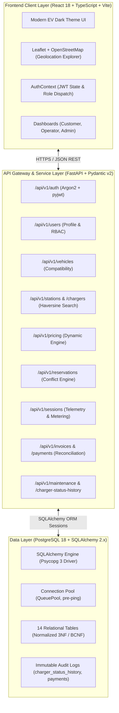
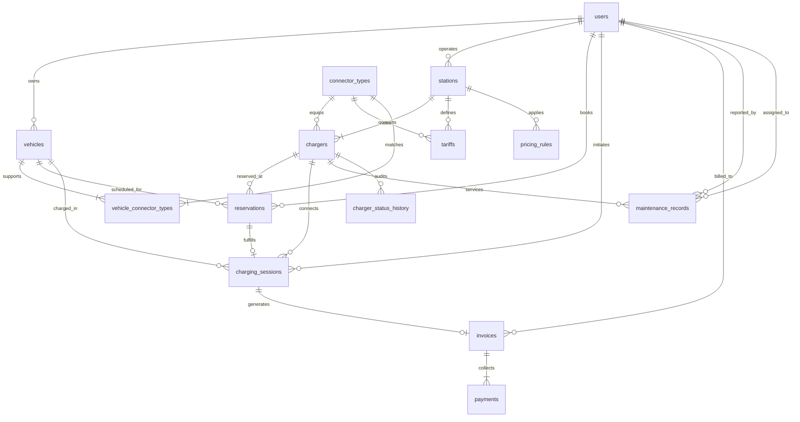

# Master Project Documentation: EV Charging Network Management System

**Project Title:** Electric Vehicle (EV) Charging Network Management System  
**Workspace:** `mh_dbms`  
**Database:** PostgreSQL 18 (`ev_charging_network`)  
**Backend:** Python 3.13 / FastAPI / SQLAlchemy 2.x / Pydantic v2  
**Frontend:** React 18 / TypeScript / Vite / Leaflet OpenStreetMap  
**Author:** Engineering Team  
**Date:** November 2026  
**Status:** Completed & Certified  

---

## 1. Project Abstract

The rapid proliferation of electric vehicles (EVs) requires robust, resilient, and highly scalable software infrastructure to coordinate physical charging equipment, energy distribution, and dynamic customer demand. 

The **EV Charging Network Management System** is an enterprise-grade Relational Database Management System (RDBMS) application engineered to solve critical operational challenges in the EV ecosystem. The system handles end-to-end station discovery via geolocation, multi-standard connector matching (CCS-2, Type 2, CHAdeMO, GB/T), dynamic time-of-use and peak-demand pricing, collision-free slot reservations, real-time energy telemetry, itemized invoicing with tax compliance, multi-attempt payment reconciliation, and maintenance work orders with full operational audit logging.

Built on **PostgreSQL 18**, **FastAPI**, and **React 18 with TypeScript**, the architecture adheres strictly to relational normalization principles (1NF through BCNF), robust transaction serialization, pessimistic concurrency controls, and comprehensive Role-Based Access Control (RBAC).

---

## 2. Problem Statement & Domain Challenges

Operating an EV charging network introduces complex technical and database challenges rarely seen in standard e-commerce systems:

1. **Hardware and Port Heterogeneity:** Vehicles support specific alternating current (AC) or direct current (DC) charging standards and physical socket types. Attempting to charge at an incompatible station damages equipment or causes user strandedness.
2. **Double-Booking & Slot Contention:** Simultaneous booking requests for the same physical bay must be resolved deterministically without race conditions.
3. **Dynamic Energy Pricing:** Electricity grid wholesale prices fluctuate continuously based on time of day, peak load, and seasonal demand. The pricing engine must calculate fair rates dynamically while snapshotting immutable figures when billing occurs.
4. **Meter Telemetry Integrity:** Charging hardware transmits cumulative energy readings (`meter_start`, `meter_end`). Network interruptions or physical disconnections require rigorous validation (`meter_end >= meter_start`) to prevent billing corruption.
5. **Financial Reconciliation & Audit Trails:** Payment gateways experience transient failures. Invoices must remain unpaid during failures, allow seamless retries, prevent duplicate payments, and track authorized refunds without mutating original transactional data.
6. **Downtime & Maintenance Tracking:** High-voltage DC fast chargers experience hardware faults. Maintenance workflows must lock the bay to prevent new reservations, track certified technician assignments, record repair expenses, and compute Mean Time to Repair (MTTR).

---

## 3. High-Level System Architecture

The application adopts a decoupled, multi-tiered architecture separating data persistence, transactional business logic, REST API contracts, and user experience.

---

## 4. Database Design & Relational Schema

### 4.1 Normalization Analysis
The database schema consists of **14 interconnected tables** designed to eliminate insertion, update, and deletion anomalies while enforcing relational integrity:

1. **First Normal Form (1NF):**
   - Every column contains atomic values. Multi-valued attributes (such as a vehicle supporting multiple connector standards) are separated into the junction table `vehicle_connector_types`.
   - Each table has a designated primary key.
2. **Second Normal Form (2NF):**
   - All non-key attributes are fully functionally dependent on the entire primary key. In the composite junction table `vehicle_connector_types(vehicle_id, connector_type_id)`, there are no partial dependencies.
3. **Third Normal Form (3NF):**
   - Transitive dependencies are removed. For example, chargers reference `station_id` and `connector_type_id`; station geographical attributes (`latitude`, `longitude`, `city`) reside in `stations`, not duplicated in `chargers`.
4. **Boyce-Codd Normal Form (BCNF):**
   - For every functional dependency $X \rightarrow Y$, $X$ is a superkey. All entity tables satisfy BCNF.

---

### 4.2 Entity-Relationship (ER) Diagram

---

### 4.3 Detailed Relational Schema Specifications (14 Tables)

#### 1. `users`
Represents platform actors including EV drivers, station operators, and administrators.
- `user_id` (INT, PK, Auto-Increment)
- `email` (VARCHAR(100), UNIQUE, NOT NULL)
- `phone` (VARCHAR(20), UNIQUE, NOT NULL)
- `first_name` (VARCHAR(50), NOT NULL)
- `last_name` (VARCHAR(50), NOT NULL)
- `role` (VARCHAR(20), NOT NULL, Check: `role IN ('CUSTOMER', 'OPERATOR', 'ADMIN')`)
- `status` (VARCHAR(20), DEFAULT 'ACTIVE', Check: `status IN ('ACTIVE', 'SUSPENDED', 'DEACTIVATED')`)
- `password_hash` (VARCHAR(255), NOT NULL, Argon2 hash)
- `created_at` (TIMESTAMP, DEFAULT NOW())

#### 2. `connector_types`
Standardized catalog of electric vehicle charging connector plugs and protocols.
- `connector_type_id` (INT, PK, Auto-Increment)
- `name` (VARCHAR(50), NOT NULL) — e.g., 'CCS-2', 'Type 2 AC', 'CHAdeMO', 'GB/T'
- `current_type` (VARCHAR(10), NOT NULL, Check: `current_type IN ('AC', 'DC')`)
- `max_power_kw` (NUMERIC(5, 2), NOT NULL)
- `description` (TEXT)

#### 3. `vehicles`
Electric vehicles registered by platform customers.
- `vehicle_id` (INT, PK, Auto-Increment)
- `user_id` (INT, FK -> `users.user_id`, NOT NULL)
- `make` (VARCHAR(50), NOT NULL)
- `model` (VARCHAR(50), NOT NULL)
- `year` (INT, NOT NULL)
- `license_plate` (VARCHAR(20), UNIQUE, NOT NULL)
- `battery_capacity_kwh` (NUMERIC(6, 2), NOT NULL)
- `created_at` (TIMESTAMP, DEFAULT NOW())

#### 4. `vehicle_connector_types`
Many-to-many junction table mapping vehicles to compatible charging connector types.
- `vehicle_id` (INT, FK -> `vehicles.vehicle_id`, PK)
- `connector_type_id` (INT, FK -> `connector_types.connector_type_id`, PK)

#### 5. `stations`
Physical charging station properties and geographic locations.
- `station_id` (INT, PK, Auto-Increment)
- `operator_id` (INT, FK -> `users.user_id`, NOT NULL)
- `station_name` (VARCHAR(100), NOT NULL)
- `address` (TEXT, NOT NULL)
- `city` (VARCHAR(50), NOT NULL)
- `latitude` (NUMERIC(9, 6), NOT NULL, Check: `latitude BETWEEN -90 AND 90`)
- `longitude` (NUMERIC(9, 6), NOT NULL, Check: `longitude BETWEEN -180 AND 180`)
- `opening_time` (TIME, NOT NULL)
- `closing_time` (TIME, NOT NULL)
- `status` (VARCHAR(20), DEFAULT 'ACTIVE', Check: `status IN ('ACTIVE', 'INACTIVE', 'MAINTENANCE')`)
- `created_at` (TIMESTAMP, DEFAULT NOW())

#### 6. `chargers`
Individually reservable physical charging bays/posts installed at stations.
- `charger_id` (INT, PK, Auto-Increment)
- `station_id` (INT, FK -> `stations.station_id`, NOT NULL)
- `connector_type_id` (INT, FK -> `connector_types.connector_type_id`, NOT NULL)
- `charger_identifier` (VARCHAR(50), NOT NULL)
- `max_power_kw` (NUMERIC(5, 2), NOT NULL)
- `status` (VARCHAR(20), DEFAULT 'ONLINE', Check: `status IN ('ONLINE', 'CHARGING', 'MAINTENANCE', 'OFFLINE')`)
- `created_at` (TIMESTAMP, DEFAULT NOW())

#### 7. `tariffs`
Base pricing schedules per kWh and fixed session connection fees.
- `tariff_id` (INT, PK, Auto-Increment)
- `station_id` (INT, FK -> `stations.station_id`, NULLABLE)
- `connector_type_id` (INT, FK -> `connector_types.connector_type_id`, NULLABLE)
- `price_per_kwh` (NUMERIC(8, 2), NOT NULL)
- `session_fee` (NUMERIC(8, 2), DEFAULT 0.00)
- `valid_from` (TIMESTAMP, NOT NULL)
- `valid_to` (TIMESTAMP, NULLABLE)
- `is_active` (BOOLEAN, DEFAULT TRUE)

#### 8. `pricing_rules`
Dynamic pricing rules adjusting base rates during peak hours, night hours, or high demand.
- `rule_id` (INT, PK, Auto-Increment)
- `station_id` (INT, FK -> `stations.station_id`, NULLABLE)
- `rule_type` (VARCHAR(30), NOT NULL, Check: `rule_type IN ('PEAK_HOUR', 'OFF_PEAK', 'DEMAND_SURGE', 'SPECIAL_EVENT')`)
- `price_multiplier` (NUMERIC(5, 3), NOT NULL)
- `start_time` (TIME, NULLABLE)
- `end_time` (TIME, NULLABLE)
- `priority` (INT, DEFAULT 0)
- `is_active` (BOOLEAN, DEFAULT TRUE)

#### 9. `reservations`
Time-slot reservations placed by customers for specific chargers.
- `reservation_id` (INT, PK, Auto-Increment)
- `user_id` (INT, FK -> `users.user_id`, NOT NULL)
- `charger_id` (INT, FK -> `chargers.charger_id`, NOT NULL)
- `vehicle_id` (INT, FK -> `vehicles.vehicle_id`, NOT NULL)
- `start_at` (TIMESTAMP, NOT NULL)
- `end_at` (TIMESTAMP, NOT NULL, Check: `end_at > start_at`)
- `status` (VARCHAR(20), DEFAULT 'CONFIRMED', Check: `status IN ('PENDING', 'CONFIRMED', 'CANCELLED', 'COMPLETED', 'EXPIRED')`)
- `created_at` (TIMESTAMP, DEFAULT NOW())

#### 10. `charging_sessions`
Active and historical electrical charging sessions with metering data.
- `session_id` (INT, PK, Auto-Increment)
- `user_id` (INT, FK -> `users.user_id`, NOT NULL)
- `charger_id` (INT, FK -> `chargers.charger_id`, NOT NULL)
- `vehicle_id` (INT, FK -> `vehicles.vehicle_id`, NOT NULL)
- `reservation_id` (INT, FK -> `reservations.reservation_id`, NULLABLE)
- `start_time` (TIMESTAMP, NOT NULL)
- `end_time` (TIMESTAMP, NULLABLE)
- `meter_start_kwh` (NUMERIC(8, 2), NOT NULL)
- `meter_end_kwh` (NUMERIC(8, 2), NULLABLE)
- `total_energy_kwh` (NUMERIC(8, 2), NULLABLE)
- `status` (VARCHAR(20), DEFAULT 'CHARGING', Check: `status IN ('CHARGING', 'COMPLETED', 'INTERRUPTED')`)

#### 11. `invoices`
Itemized financial billing records generated upon session completion.
- `invoice_id` (INT, PK, Auto-Increment)
- `session_id` (INT, FK -> `charging_sessions.session_id`, UNIQUE, NOT NULL)
- `user_id` (INT, FK -> `users.user_id`, NOT NULL)
- `base_amount` (NUMERIC(10, 2), NOT NULL)
- `tax_amount` (NUMERIC(10, 2), NOT NULL)
- `total_amount` (NUMERIC(10, 2), NOT NULL)
- `status` (VARCHAR(20), DEFAULT 'UNPAID', Check: `status IN ('UNPAID', 'PAID', 'CANCELLED', 'REFUNDED')`)
- `issued_at` (TIMESTAMP, DEFAULT NOW())

#### 12. `payments`
Financial transaction attempts across supported payment providers.
- `payment_id` (INT, PK, Auto-Increment)
- `invoice_id` (INT, FK -> `invoices.invoice_id`, NOT NULL)
- `amount` (NUMERIC(10, 2), NOT NULL)
- `payment_method` (VARCHAR(30), NOT NULL, Check: `payment_method IN ('CREDIT_CARD', 'DEBIT_CARD', 'UPI', 'WALLET', 'DEMO')`)
- `status` (VARCHAR(20), DEFAULT 'PENDING', Check: `status IN ('PENDING', 'SUCCESS', 'FAILED', 'REFUNDED')`)
- `transaction_reference` (VARCHAR(100), UNIQUE, NOT NULL)
- `paid_at` (TIMESTAMP, NULLABLE)

#### 13. `maintenance_records`
Equipment repair tickets and technician work orders.
- `maintenance_id` (INT, PK, Auto-Increment)
- `charger_id` (INT, FK -> `chargers.charger_id`, NOT NULL)
- `reported_by` (INT, FK -> `users.user_id`, NOT NULL)
- `assigned_to` (INT, FK -> `users.user_id`, NULLABLE)
- `description` (TEXT, NOT NULL)
- `priority` (VARCHAR(10), NOT NULL, Check: `priority IN ('LOW', 'MEDIUM', 'HIGH', 'CRITICAL')`)
- `status` (VARCHAR(20), DEFAULT 'OPEN', Check: `status IN ('OPEN', 'IN_PROGRESS', 'RESOLVED', 'CLOSED')`)
- `cost` (NUMERIC(10, 2), NULLABLE)
- `created_at` (TIMESTAMP, DEFAULT NOW())
- `resolved_at` (TIMESTAMP, NULLABLE)

#### 14. `charger_status_history`
Chronological, append-only operational audit log for all charger state transitions.
- `history_id` (INT, PK, Auto-Increment)
- `charger_id` (INT, FK -> `chargers.charger_id`, NOT NULL)
- `old_status` (VARCHAR(20), NOT NULL)
- `new_status` (VARCHAR(20), NOT NULL)
- `changed_by` (INT, FK -> `users.user_id`, NOT NULL)
- `change_reason` (TEXT, NULLABLE)
- `changed_at` (TIMESTAMP, DEFAULT NOW())

---

## 5. Architectural Deep Dive: Functional Modules 1–10

### Module 1: Workspace and Database Ground-Truth Verification
- Established read-only transaction parameters to inspect PostgreSQL 18 without mutating existing state.
- Verified 14 tables and 54 pre-populated seed rows.
- Structured automated reporting scripts (`db_inspector.py`) producing structured JSON and Markdown audit logs.

### Module 2: Backend Core & Database Integration
- Implemented **SQLAlchemy 2.x Declarative Base** models matching PostgreSQL table definitions exactly.
- Configured connection pooling with `QueuePool`, recycling expired connections and validating with pre-ping.
- Constructed unified health checking endpoints (`GET /api/v1/health`, `GET /api/v1/health/db-check`).

### Module 3: Authentication and User Management
- Integrated **Argon2id** password hashing (`pwdlib`), delivering resistance to side-channel and brute-force attacks.
- Configured cryptographically signed JSON Web Tokens (`pyjwt`) with configurable expiry.
- Built reusable role verification dependencies: `require_role`, `require_admin`, `require_operator_or_admin`.
- Implemented user registration, login, profile management, and admin user administration.

### Module 4: Vehicle and Connector Management
- Engineered vehicle profile creation with battery capacity specifications.
- Implemented atomic multi-port connector mapping via junction table `vehicle_connector_types`.
- Enforced strict customer data isolation: users can only view, edit, or delete vehicles registered to their own account.

### Module 5: Station and Charger Management with Geolocation
- Implemented station directory with operating hours (`opening_time`, `closing_time`).
- Engineered **Haversine Great-Circle Distance** query logic:
  $$d = 2r \arcsin\left(\sqrt{\sin^2\left(\frac{\Delta \phi}{2}\right) + \cos(\phi_1)\cos(\phi_2)\sin^2\left(\frac{\Delta \lambda}{2}\right)}\right)$$
- Supported real-time proximity filtering (`/search/nearby?lat=...&lon=...&radius_km=...`).
- Instrumented charger state transitions with automated entries into `charger_status_history`.

### Module 6: Tariffs and Dynamic Pricing Calculation Engine
- Developed dynamic price resolution prioritizing connector-specific tariffs over station-level fallbacks.
- Structured multi-factor pricing rules:
  - **Peak Hour Surge:** Applies multipliers during high-load grid periods (e.g. 1.25x between 17:00 and 21:00).
  - **Off-Peak Night Discount:** Incentive pricing during surplus hours (e.g. 0.85x between 23:00 and 06:00).
  - **Demand Multipliers:** Priority-based resolution of compounding rules.
- Created pure, read-only price estimator API (`GET /api/v1/pricing/quote`) returning itemized cost breakdowns.

### Module 7: Reservation Management and Slot Conflict Engine
- Standardized booking windows using half-open time interval semantics: $[start, end)$.
- Implemented pessimistic row-level locking (`with_for_update()`) during slot creation to serialize concurrent booking attempts on the same charger.
- Validated vehicle-to-charger connector compatibility prior to booking.
- Designed PostgreSQL GiST exclusion constraint proposal (`proposed_reservation_exclusion_constraint.sql`) for native zero-latency constraint enforcement.

### Module 8: Charging Session Management and Energy Metering
- Engineered session activation supporting both walk-in customers and reservation check-ins (with a $\pm 30$-minute arrival window).
- Enforced physical bay exclusivity: a charger can host at most one active session (`CHARGING`) at any moment.
- Validated hardware meter readings:
  $$\text{total\_energy\_kwh} = \text{meter\_end\_kwh} - \text{meter\_start\_kwh} \quad (\text{ensuring } \text{meter\_end} \ge \text{meter\_start})$$
- Captured immutable tariff snapshots upon session start to prevent retroactive price manipulation.
- Implemented graceful completion and abrupt interruption workflows.

### Module 9: Invoicing and Payment Reconciliation
- Implemented automated invoice generation from completed charging sessions:
  $$\text{base\_charge} = \text{energy\_kwh} \times (\text{rate\_per\_kwh} \times \text{multiplier}) + \text{session\_fee}$$
  $$\text{tax\_charge} = \text{base\_charge} \times 0.18 \quad (18\% \text{ GST})$$
  $$\text{total\_amount} = \text{base\_charge} + \text{tax\_charge}$$
- Standardized financial rounding using `ROUND_HALF_UP` on `Decimal` objects.
- Built mock payment gateway provider (`DEMO`) with deterministic failure simulation.
- Preserved failed payment attempts as immutable audit records (`status="FAILED"`, `paid_at=None`) while keeping invoices `UNPAID` until a successful transaction occurs.
- Prevented double-payment and overpayment using row-level locking on invoice checkout.
- Implemented operator/admin revenue reporting APIs with station-level breakdown.

### Module 10: Maintenance Work Orders and Charger Status Audit Trail
- Designed fault reporting and ticketing lifecycle (`OPEN` $\rightarrow$ `IN_PROGRESS` $\rightarrow$ `RESOLVED` $\rightarrow$ `CLOSED`).
- Integrated safety interlocks: assigning a technician automatically locks the charger to `MAINTENANCE`, preventing new reservations or session starts.
- Enforced technician role validation (`require_role(["OPERATOR", "ADMIN"])`).
- Implemented operator safety clearance protocol: bay cannot return to `ONLINE` without explicit operator verification.
- Developed Mean Time to Repair (MTTR) analytics engine computing:
  $$\text{MTTR} = \frac{\sum (\text{resolved\_at} - \text{created\_at})}{N_{\text{resolved}}}$$

---

## 6. Advanced DBMS Concepts Applied

| Advanced DBMS Concept | Practical Implementation in EV System |
| :--- | :--- |
| **ACID Transactions** | Multi-table workflows (e.g. session complete $\rightarrow$ bay release $\rightarrow$ invoice creation $\rightarrow$ audit trail) are wrapped in atomic SQLAlchemy transactions with automatic rollback on error. |
| **Pessimistic Concurrency Control** | Queries in slot booking and payment processing employ `SELECT ... FOR UPDATE` (`with_for_update()`), preventing race conditions, phantom reads, and double-bookings. |
| **Half-Open Intervals $[start, end)$** | Slot intervals allow back-to-back reservations without dead time: Slot 1 ending at 15:00 and Slot 2 starting at 15:00 do not overlap. |
| **PostgreSQL GiST Constraints** | Designed native database exclusion constraints using `btree_gist` extension to mathematically enforce non-overlapping time ranges on chargers. |
| **Financial Decimal Quantization** | Monetary calculations utilize Python's `decimal.Decimal` with explicit `ROUND_HALF_UP` quantization, preventing IEEE 754 floating-point rounding errors. |
| **Multi-Version Concurrency (MVCC)** | Read operations (such as pricing quotes, nearby station searches, and audit reports) operate in non-blocking read-committed isolation. |
| **Append-Only Audit Logging** | Charger status transitions and payment attempts are appended to immutable audit tables, ensuring tamper-evident accountability. |

---

## 7. System Limitations & Future Enhancements

1. **OCPP (Open Charge Point Protocol) 2.0.1 Integration:**
   - *Current State:* Telemetry is simulated via REST endpoints.
   - *Enhancement:* Deploy a WebSocket server implementing OCPP 2.0.1 for bi-directional machine-to-machine communication with physical EVSE hardware.
2. **Dynamic Grid Load Balancing:**
   - *Current State:* Stations have fixed maximum power capacities.
   - *Enhancement:* Implement dynamic load curtailment algorithms that throttle charger power based on real-time transformer capacity and grid frequency.
3. **Automated Production Migration Pipeline:**
   - *Current State:* Database schema was kept 100% frozen per project constraints; proposed schema enhancements are documented in standalone SQL files.
   - *Enhancement:* Execute `alembic` migration scripts during blue-green deployment windows to apply GiST exclusion constraints and refund tracking columns.
4. **Third-Party Payment Gateways:**
   - *Current State:* Supported via a flexible `GatewayProvider` abstraction with active `DEMO` provider.
   - *Enhancement:* Attach live webhook handlers for Stripe, Razorpay, and PayPal.

---

## 8. Verification & Test Evidence Summary

- **Total Unit & Integration Tests:** 164 passing tests across 11 test modules.
- **Total End-to-End Tests:** 8 passing comprehensive workflows.
- **TypeScript & Frontend Build:** 0 compilation errors, production build verified.
- **Relational Integrity:** 14/14 tables verified, 54/54 original seed records verified intact.

