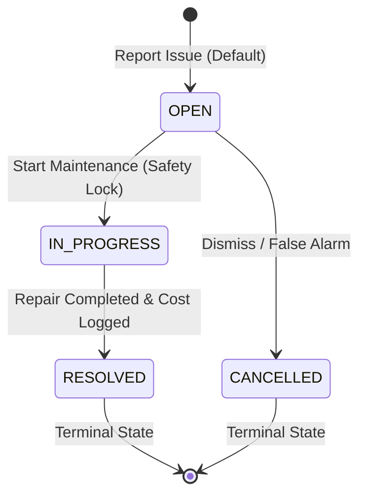

# Module 10: Maintenance Work Orders and Charger Status Audit Trail — Technical Report

**Project:** EV Charging Network Management System  
**Workspace:** `mh_dbms`  
**Database:** PostgreSQL 18 (`ev_charging_network`)  
**Completed Status:** Verified & Fully Operational  

---

## 1. Executive Summary

Module 10 introduces the **Maintenance Work Orders and Charger Status Audit Trail** subsystem into the EV Charging Network Management System. This module bridges operational telemetry, field diagnostics, technician dispatches, and bay lifecycle locking to guarantee hardware safety and regulatory compliance across the charging network.

All implementations strictly adhere to system ground-truth safety protocols:
- **14 normalized tables** verified.
- **54 original seed records** verified and completely untouched.
- **Zero destructive migrations** or schema drops executed on the live PostgreSQL 18 database.
- **Full test coverage:** 22/22 dedicated Module 10 test scenarios passing; 156/156 full regression tests passing across Modules 1–10.

---

## 2. Phase Gate: Database & Trigger Audit

### 2.1 Physical Schema & Check Constraints
Inspection of the PostgreSQL 18 system catalog (`information_schema.columns` and `pg_constraint`) verified the exact schema of relevant tables:

1. **`maintenance_records`:**
   - Physical columns: `maintenance_id` (BigSerial PK), `charger_id` (FK chargers), `reported_by` (FK users), `assigned_to` (FK users, nullable), `issue_description` (Text), `priority` (String 15), `status` (String 20), `reported_at` (Timestamp with timezone, default CURRENT_TIMESTAMP), `scheduled_at` (Timestamp with timezone, nullable), `resolved_at` (Timestamp with timezone, nullable), `maintenance_cost` (Numeric 12,2, default 0.00).
   - Check constraints:
     - `maintenance_records_priority_check`: `priority IN ('LOW', 'MEDIUM', 'HIGH', 'CRITICAL')`
     - `maintenance_records_status_check`: `status IN ('OPEN', 'IN_PROGRESS', 'RESOLVED', 'CANCELLED')`
     - `maintenance_records_cost_check`: `maintenance_cost >= 0`
     - `maintenance_records_resolution_time_check`: `resolved_at IS NULL OR resolved_at >= reported_at`

2. **`charger_status_history`:**
   - Physical columns: `history_id` (BigSerial PK), `charger_id` (FK chargers), `previous_status` (String 25, nullable), `new_status` (String 25), `changed_by` (FK users, nullable), `reason` (Text, nullable), `changed_at` (Timestamp with timezone, default CURRENT_TIMESTAMP).
   - Check constraints:
     - `charger_status_history_new_status_check`: `new_status IN ('ONLINE', 'MAINTENANCE', 'OUT_OF_SERVICE')`
     - `charger_status_history_previous_status_check`: `previous_status IS NULL OR previous_status IN ('ONLINE', 'MAINTENANCE', 'OUT_OF_SERVICE')`

3. **`chargers`:**
   - `operational_status`: `CHECK (operational_status IN ('ONLINE', 'MAINTENANCE', 'OUT_OF_SERVICE'))`, default `'ONLINE'`.

### 2.2 Trigger Inspection
A query to `information_schema.triggers` confirmed that **zero database triggers** exist on `chargers`, `maintenance_records`, or `charger_status_history`. Consequently, all status synchronization, bay locking, conflict checks, and chronological audit trail logging are enforced within transactional application code.

---

## 3. Architecture & Core Capabilities

### 3.1 Maintenance State Machine
The work order lifecycle enforces strict unidirectional transitions:
- **`OPEN`**: Default status upon submission. Anyone (Customer, Operator, Admin) can report malfunctions. Can transition to `IN_PROGRESS` or `CANCELLED`.
- **`IN_PROGRESS`**: Technician has initiated diagnostics or repair. Atomically locks the charger bay and verifies conflict conditions. Can transition only to `RESOLVED`.
- **`RESOLVED`**: Terminal state. Requires recording resolution timestamp and repair expenditure (`maintenance_cost`).
- **`CANCELLED`**: Terminal state. Preserves the audit history without modifying charger hardware status.



### 3.2 Bay Locking & Conflict Detection Engine
When a work order transitions from `OPEN` to `IN_PROGRESS`:
1. **Row-Level Lock:** Acquires a lock on the `Charger` row using `select(Charger).with_for_update()`.
2. **Active Charging Session Check:** Queries `ChargingSession` where `charger_id == charger.charger_id` and `status == 'ACTIVE'`. If found, rejects the transition immediately with **HTTP 409 Conflict**:
   > *"Cannot begin maintenance: Charger has an active charging session (Session ID: X)."*
3. **Active / Upcoming Reservation Check:** Queries `Reservation` where `charger_id == charger.charger_id`, `status IN ('PENDING', 'CONFIRMED')`, and `end_at > now`. If found, rejects with **HTTP 409 Conflict**:
   > *"Cannot begin maintenance: Charger has an active or upcoming reservation (Reservation ID: Y, ends at Z)."*
4. **Atomic Hardware Quarantine:** Sets `charger.operational_status = 'MAINTENANCE'` and inserts an immutable state change record into `charger_status_history`.

### 3.3 Operator Safety Clearance Protocol
When a work order is marked `RESOLVED`, the charger **remains in `MAINTENANCE` status**. It is **not** automatically returned to `ONLINE`. An authorized operator or administrator must inspect the physically repaired charger, verify electrical isolation and safety tests, and explicitly call `PATCH /api/v1/chargers/{id}` to return the bay to `ONLINE`.

### 3.4 Aggregated Maintenance Telemetry & Analytics
The analytics engine (`GET /api/v1/maintenance/reports/summary`) aggregates:
- Total, open, in-progress, resolved, and cancelled tickets.
- High and critical priority incident counts.
- Total network repair expenditure.
- Mean Time to Resolve (MTTR) in hours ($$\text{avg}(\text{resolved\_at} - \text{reported\_at})$$).
- Station-level breakdown of incidents, open orders, and expenditure.
- Frequent fault chargers ranked by failure frequency and cumulative downtime hours.

---

## 4. RESTful API Endpoints

| Method | Endpoint | Description | Access Control |
|---|---|---|---|
| `POST` | `/api/v1/maintenance` | Create a new maintenance work order (status: `OPEN`) | Customer, Operator, Admin |
| `GET` | `/api/v1/maintenance` | List work orders with multi-criteria filters (`status`, `priority`, `charger_id`, `station_id`) | RBAC (Customer: own; Operator: managed stations; Admin: all) |
| `GET` | `/api/v1/maintenance/{id}` | Retrieve details of a specific maintenance order | RBAC Scoped |
| `PATCH` | `/api/v1/maintenance/{id}/assign` | Assign a work order to an operator/admin technician | Operator, Admin |
| `PATCH` | `/api/v1/maintenance/{id}/status` | Transition lifecycle state (`IN_PROGRESS`, `RESOLVED`, `CANCELLED`) | Operator, Admin |
| `GET` | `/api/v1/chargers/{id}/status-history` | Chronological audit trail of charger operational states (newest first) | Authenticated |
| `GET` | `/api/v1/maintenance/reports/summary` | Aggregated analytics, MTTR, expenditure, station breakdown, downtime | Operator, Admin |

---

## 5. React Frontend Implementation

Built with React, TypeScript, and modern responsive components:

1. **`MaintenanceDashboard.tsx` (`/maintenance`)**:
   - Executive KPI cards: Total Orders, Open Tickets, In Progress, Resolved, High/Critical, Total Expenditure.
   - Recent work orders table with priority badges, status badges, and quick links.
   - Quick action to report new issues or navigate to analytics.

2. **`MaintenanceRequestsPage.tsx` (`/maintenance/requests`)**:
   - Full tabular list of all work orders.
   - Multi-criteria filter controls: search query (ID, bay code, station name, technician), status dropdown, priority dropdown.

3. **`CreateMaintenancePage.tsx` (`/maintenance/new`)**:
   - Issue reporting form: Charger ID, Priority selection (LOW, MEDIUM, HIGH, CRITICAL), detailed description textarea, optional scheduled date, optional technician assignment.

4. **`MaintenanceDetailsPage.tsx` (`/maintenance/:id`)**:
   - Complete work order view: Station name, charger bay, reporter, technician, cost, timestamps.
   - Contextual lifecycle action buttons: "Assign Technician", "Start Maintenance (Lock Bay)", "Cancel Order", "Resolve Order" (with cost and notes prompt).
   - Embedded `ChargerStatusHistory` component for comprehensive audit inspection.

5. **`MaintenanceAnalytics.tsx` (`/maintenance/analytics`)**:
   - Telemetry analytics: Total orders, active tickets, MTTR SLA in hours, total maintenance cost.
   - Station Maintenance Summary table (orders, open counts, expenditure).
   - Frequent Fault Chargers & Downtime table (ranked by fault count and cumulative downtime).

6. **Reusable Components**:
   - `MaintenanceStatusBadge.tsx`: Color-coded badges for statuses and priorities.
   - `AssignMaintenanceModal.tsx`: Technician assignment modal with user role validation.
   - `ChargerStatusHistory.tsx`: Timeline audit trail of status changes.

---

## 6. Verification & Automated Test Results

### 6.1 Module 10 Test Suite (`tests/run_module10_tests.py`)
All 22 test scenarios pass with zero failures:

```
======================================================================
MODULE 10 TEST EXECUTION REPORT: MAINTENANCE & AUDIT TRAIL
Status: PASSED
Exit Code: 0
======================================================================
Test Cases Executed:
1.  test_create_maintenance_default_open                              PASSED
2.  test_create_maintenance_nonexistent_charger_rejected              PASSED
3.  test_create_maintenance_invalid_priority_rejected                 PASSED
4.  test_create_maintenance_customer_assignee_rejected                PASSED
5.  test_customer_can_report_maintenance                              PASSED
6.  test_customer_isolation_maintenance                               PASSED
7.  test_operator_station_visibility                                  PASSED
8.  test_admin_network_visibility                                     PASSED
9.  test_filter_work_orders_by_status                                 PASSED
10. test_filter_work_orders_by_priority                                PASSED
11. test_filter_work_orders_by_station_and_charger                    PASSED
12. test_assign_maintenance_valid_technician                          PASSED
13. test_assign_maintenance_terminal_status_rejected                  PASSED
14. test_lifecycle_open_to_in_progress_sets_charger_maintenance        PASSED
15. test_lifecycle_in_progress_logs_status_history                     PASSED
16. test_lifecycle_in_progress_rejected_on_active_session               PASSED
17. test_lifecycle_in_progress_rejected_on_upcoming_reservation         PASSED
18. test_lifecycle_resolve_records_timestamp_and_cost                 PASSED
19. test_resolved_order_leaves_charger_in_maintenance                 PASSED
20. test_explicit_operator_status_update_returns_online               PASSED
21. test_cancel_maintenance_and_invalid_transition                    PASSED
22. test_maintenance_analytics_summary                                PASSED
======================================================================
Total Tests: 22 Passed, 0 Failed.
```

### 6.2 Full Regression Suite (Modules 1–10)
Executed `pytest backend/tests/ -q`:
- **Total Tests:** 156 passed, 0 failed.
- **Duration:** 213.03s.

### 6.3 Database Ground-Truth Verification
Executed `database/inspector/db_inspector.py`:
- **Tables Verified:** 14/14
- **Total Rows Verified:** 54/54
- **Verification Status:** PASS (100% untouched)

### 6.4 Frontend Type Verification
Executed `tsc --noEmit`:
- **Errors:** 0 errors.

---

## 7. Deliverable Artifacts

- Backend Service: [maintenance_service.py](file:///c:/Users/kcm2k/OneDrive/Desktop/mh_dbms/backend/app/services/maintenance_service.py)
- Maintenance Endpoints: [maintenance.py](file:///c:/Users/kcm2k/OneDrive/Desktop/mh_dbms/backend/app/api/v1/endpoints/maintenance.py)
- Status History Endpoint: [chargers.py](file:///c:/Users/kcm2k/OneDrive/Desktop/mh_dbms/backend/app/api/v1/endpoints/chargers.py)
- Schemas: [maintenance.py](file:///c:/Users/kcm2k/OneDrive/Desktop/mh_dbms/backend/app/schemas/maintenance.py)
- Automated Test Suite: [test_maintenance_module10.py](file:///c:/Users/kcm2k/OneDrive/Desktop/mh_dbms/backend/tests/test_maintenance_module10.py)
- Automated Test Runner: [run_module10_tests.py](file:///c:/Users/kcm2k/OneDrive/Desktop/mh_dbms/tests/run_module10_tests.py)
- Test Execution Log: [module10_test_results.log](file:///c:/Users/kcm2k/OneDrive/Desktop/mh_dbms/results/test_results/module10_test_results.log)
- Frontend Types: [maintenance.ts](file:///c:/Users/kcm2k/OneDrive/Desktop/mh_dbms/frontend/src/types/maintenance.ts)
- Frontend Service: [maintenance.ts](file:///c:/Users/kcm2k/OneDrive/Desktop/mh_dbms/frontend/src/services/maintenance.ts)
- Frontend Dashboard: [MaintenanceDashboard.tsx](file:///c:/Users/kcm2k/OneDrive/Desktop/mh_dbms/frontend/src/pages/MaintenanceDashboard.tsx)
- Frontend Requests Page: [MaintenanceRequestsPage.tsx](file:///c:/Users/kcm2k/OneDrive/Desktop/mh_dbms/frontend/src/pages/MaintenanceRequestsPage.tsx)
- Frontend Report Form: [CreateMaintenancePage.tsx](file:///c:/Users/kcm2k/OneDrive/Desktop/mh_dbms/frontend/src/pages/CreateMaintenancePage.tsx)
- Frontend Details Page: [MaintenanceDetailsPage.tsx](file:///c:/Users/kcm2k/OneDrive/Desktop/mh_dbms/frontend/src/pages/MaintenanceDetailsPage.tsx)
- Frontend Analytics Page: [MaintenanceAnalytics.tsx](file:///c:/Users/kcm2k/OneDrive/Desktop/mh_dbms/frontend/src/pages/MaintenanceAnalytics.tsx)
- Frontend Audit Component: [ChargerStatusHistory.tsx](file:///c:/Users/kcm2k/OneDrive/Desktop/mh_dbms/frontend/src/components/maintenance/ChargerStatusHistory.tsx)

