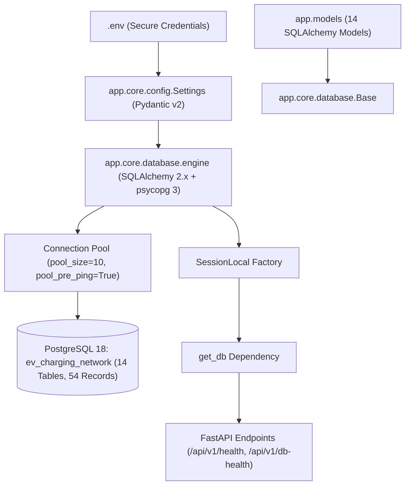

# Module 2 Report: Backend Core & Database Integration

**Project:** EV Charging Network Management System  
**Database:** PostgreSQL 18 (`ev_charging_network`)  
**Status:** COMPLETE & VERIFIED  
**Date:** November 2026  

---

## 1. Executive Summary

Module 2 establishes the complete backend infrastructure, connection pooling, and ORM mapping for the **EV Charging Network Management System**. It integrates **SQLAlchemy 2.x** with the modern **psycopg 3** driver, implementing connection pooling and connection pre-ping. All **14 existing tables** have been mapped to declarative SQLAlchemy models without altering the underlying database or mutating any of the **54 pre-existing dummy records**.

---

## 2. Implemented Architecture



---

## 3. Database Connection & Pool Configuration

The database connection is configured in `backend/app/core/database.py` with:
- **Driver:** `postgresql+psycopg://` (psycopg 3 binary)
- **Pooling Settings:**
  - `pool_size`: 10 persistent connections
  - `max_overflow`: 20 burst connections
  - `pool_timeout`: 30 seconds
  - `pool_pre_ping`: `True` (proactively tests connection liveness before checkout to prevent stale connections)
  - `pool_recycle`: 1800 seconds (30 minutes)
- **Session Dependency:** `get_db` generator with automatic rollback on exception and guaranteed session closure.

---

## 4. ORM Model Mapping Matrix (14 Tables)

| # | Model Class | Database Table | Primary Key | Foreign Key References | Mapped Row Count |
| :-: | :--- | :--- | :--- | :--- | :-: |
| 1 | `User` | `users` | `user_id` (BigInteger) | None | 5 |
| 2 | `ConnectorType` | `connector_types` | `connector_type_id` (Integer) | None | 4 |
| 3 | `Vehicle` | `vehicles` | `vehicle_id` (BigInteger) | `users.user_id` | 3 |
| 4 | `VehicleConnectorType` | `vehicle_connector_types` | `(vehicle_id, connector_type_id)` | `vehicles.vehicle_id`, `connector_types.connector_type_id` | 6 |
| 5 | `Station` | `stations` | `station_id` (BigInteger) | `users.user_id` | 3 |
| 6 | `Charger` | `chargers` | `charger_id` (BigInteger) | `stations.station_id`, `connector_types.connector_type_id` | 5 |
| 7 | `Tariff` | `tariffs` | `tariff_id` (BigInteger) | `stations.station_id`, `connector_types.connector_type_id` | 4 |
| 8 | `PricingRule` | `pricing_rules` | `rule_id` (BigInteger) | `tariffs.tariff_id` | 3 |
| 9 | `Reservation` | `reservations` | `reservation_id` (BigInteger) | `users.user_id`, `vehicles.vehicle_id`, `chargers.charger_id` | 7 |
| 10 | `ChargingSession` | `charging_sessions` | `session_id` (BigInteger) | `reservations.reservation_id`, `users.user_id`, `vehicles.vehicle_id`, `chargers.charger_id`, `tariffs.tariff_id` | 3 |
| 11 | `Invoice` | `invoices` | `invoice_id` (BigInteger) | `charging_sessions.session_id` | 2 |
| 12 | `Payment` | `payments` | `payment_id` (BigInteger) | `invoices.invoice_id` | 3 |
| 13 | `MaintenanceRecord` | `maintenance_records` | `maintenance_id` (BigInteger) | `chargers.charger_id`, `users.user_id` (reporter & assignee) | 2 |
| 14 | `ChargerStatusHistory` | `charger_status_history` | `history_id` (BigInteger) | `chargers.charger_id`, `users.user_id` | 4 |
| **Total** | **14 Models** | **14 Tables** | | | **54 Records** |

---

## 5. Health Check APIs

Implemented in `backend/app/api/v1/endpoints/health.py`:

### 1. `GET /api/v1/health`
- **Purpose:** Fast lightweight endpoint for uptime monitoring and container probes.
- **Sample Output:**
  ```json
  {
    "status": "healthy",
    "project": "EV Charging Network Management System",
    "version": "1.0.0",
    "timestamp": "2026-11-12T17:17:54.489475+00:00"
  }
  ```

### 2. `GET /api/v1/db-health`
- **Purpose:** Executes a read-only metadata query to verify live PostgreSQL connectivity.
- **Sample Output:**
  ```json
  {
    "status": "healthy",
    "database_name": "ev_charging_network",
    "version": "PostgreSQL 18.7 on x86_64-windows, compiled by msvc-19.44.35229, 64-bit",
    "table_count": 14,
    "driver": "psycopg 3 (SQLAlchemy 2.x)"
  }
  ```

---

## 6. Test Verification & Safety Results

Automated test runner executed `pytest backend/tests/`:
```
backend/tests/test_database_core.py::test_db_engine_connectivity PASSED
backend/tests/test_database_core.py::test_db_version_is_postgresql_18 PASSED
backend/tests/test_database_core.py::test_14_tables_exist_in_information_schema PASSED
backend/tests/test_database_core.py::test_sqlalchemy_metadata_registers_14_tables PASSED
backend/tests/test_database_core.py::test_sqlalchemy_models_query_existing_54_records PASSED
backend/tests/test_health_endpoints.py::test_api_health_endpoint PASSED
backend/tests/test_health_endpoints.py::test_db_health_endpoint PASSED
backend/tests/test_health_endpoints.py::test_root_endpoint PASSED

======================== 8 passed in 5.07s =========================
```

- **Database Preservation Audit:** All 14 tables and all 54 dummy records were re-verified post-testing via `db_inspector.py`.
- **Destructive Operations Avoidance:** `Base.metadata.create_all()` was strictly omitted. No DDL commands or table alters were executed.

