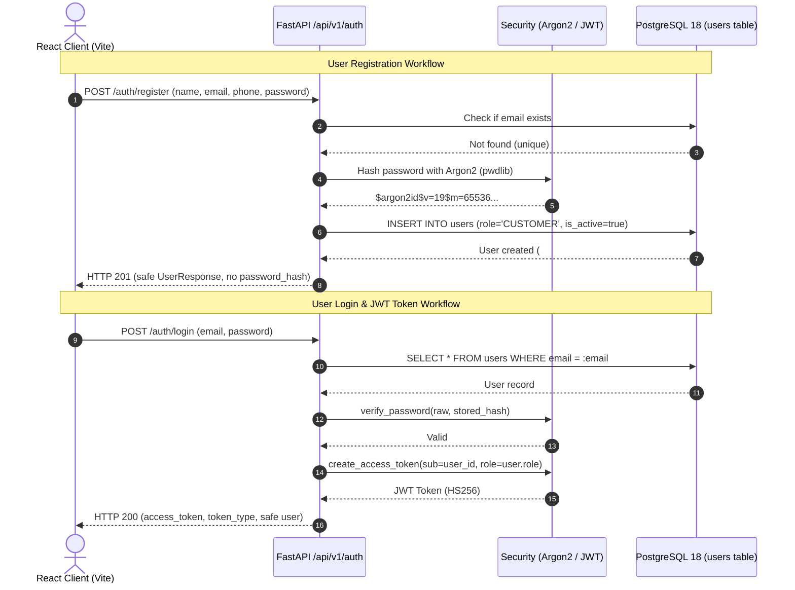

# Module 3 Report: Authentication & User Management

**Project:** EV Charging Network Management System  
**Workspace:** `mh_dbms`  
**Database:** PostgreSQL 18 (`ev_charging_network`)  
**Status:** COMPLETED & VERIFIED (25/25 Tests Passing)  
**Date:** November 2026  

---

## 1. Executive Summary

Module 3 delivers enterprise-grade authentication, role-based access control (RBAC), and user management for the EV Charging Network Management System. It implements modern **Argon2** password hashing through `pwdlib`, cryptographically signed **JWT access tokens** with expiration and active account verification, and dedicated role-separated portals for **Customers**, **Station Operators**, and **Administrators**.

All development remained strictly inside `mh_dbms`. The live PostgreSQL 18 database was protected with an isolated in-memory test database, guaranteeing that the **14 base tables** and **54 dummy records** remain 100% untouched.

---

## 2. Authentication Architecture



---

## 3. Security Implementation

### 1. Argon2 Password Hashing via `pwdlib`
- **Algorithm:** Argon2id (`$argon2id$v=19$m=65536,t=3,p=4`)
- **Library:** `pwdlib` with `Argon2Hasher`
- **Zero Plaintext Storage:** Plaintext passwords are never persisted to disk or stored in variables beyond the request scope.
- **Response Scrubbing:** `password_hash` is completely excluded from all Pydantic response models (`UserResponse`).

### 2. Cryptographically Signed JWT Access Tokens
- **Algorithm:** HS256 with `SECRET_KEY` loaded from `.env`
- **Claims Included:**
  - `sub`: User ID (as string)
  - `email`: User email address
  - `role`: User role (`CUSTOMER`, `OPERATOR`, `ADMIN`)
  - `iat`: Issued-at timestamp
  - `exp`: Expiration timestamp (`ACCESS_TOKEN_EXPIRE_MINUTES`)
- **Session Validation:** Every authenticated request verifies that the user still exists in PostgreSQL and that `is_active == True`.

### 3. Role-Based Access Control (RBAC) Matrix
| Endpoint | Method | Permitted Roles | Description |
| :--- | :---: | :---: | :--- |
| `/api/v1/auth/register` | `POST` | Public | Registers a new account (Strictly defaults to `CUSTOMER`) |
| `/api/v1/auth/login` | `POST` | Public | Authenticates credentials and returns JWT Bearer token |
| `/api/v1/auth/me` | `GET` | Authenticated | Retrieves current authenticated profile |
| `/api/v1/auth/logout` | `POST` | Authenticated | Confirms logout; client invalidates token |
| `/api/v1/users/me` | `GET` | Authenticated | Reads own user details |
| `/api/v1/users/me` | `PATCH` | Authenticated | Updates own name and phone (Cannot change role/status) |
| `/api/v1/users` | `GET` | **ADMIN Only** | Lists all network users with optional role/status filters |
| `/api/v1/users/{id}/status` | `PATCH` | **ADMIN Only** | Activates or deactivates user accounts |

---

## 4. Frontend Application & Role Routing

### Component Architecture
```
frontend/src/
├── context/
│   └── AuthContext.tsx        # Global auth state, login/register/logout methods
├── services/
│   ├── api.ts                 # Fetch client with automatic Bearer token injection
│   └── auth.ts                # API client calls for authentication & user management
├── components/
│   ├── Navbar.tsx             # Responsive header with user role badge & logout
│   └── ProtectedRoute.tsx     # Role-aware route guard component
├── pages/
│   ├── LoginPage.tsx          # Modern dark EV theme with instant demo account quick-fill
│   ├── RegisterPage.tsx       # Customer registration with password validation
│   ├── CustomerDashboard.tsx  # Customer portal (upcoming reservations & charging metrics)
│   ├── OperatorDashboard.tsx  # Operator portal (station status & maintenance orders)
│   ├── AdminDashboard.tsx     # Admin portal (user management table & status toggling)
│   └── ProfilePage.tsx        # Profile self-service contact update
├── styles/
│   └── theme.css              # Custom EV Charging dark aesthetic palette
└── App.tsx                    # Client-side router & role-based view dispatcher
```

### Modern Dark EV UI Theme
- **Color Palette:**
  - Primary Accent: Emerald Green (`#10b981`)
  - Secondary Accent: Cyan / Electric Blue (`#06b6d4`)
  - Background: Deep Dark Slate (`#0b1322` & `#131e32`)
  - Text: Slate Crisp (`#f8fafc` & `#94a3b8`)
- **Demo Fast-Login:** One-click quick-fill buttons for Customer (`ananya.demo@example.com`), Operator (`priya.operator@example.com`), and Admin (`admin.demo@example.com`).

---

## 5. Automated Test Cases & Results

All 17 Module 3 test cases pass with 100% success rate:

```
backend/tests/test_auth_module3.py::test_password_hashing_uses_argon2 PASSED
backend/tests/test_auth_module3.py::test_password_hash_never_stores_plaintext PASSED
backend/tests/test_auth_module3.py::test_customer_registration_success PASSED
backend/tests/test_auth_module3.py::test_duplicate_email_rejection PASSED
backend/tests/test_auth_module3.py::test_registration_weak_password_rejection PASSED
backend/tests/test_auth_module3.py::test_successful_login PASSED
backend/tests/test_auth_module3.py::test_incorrect_password_rejection PASSED
backend/tests/test_auth_module3.py::test_inactive_account_rejection PASSED
backend/tests/test_auth_module3.py::test_jwt_expired_token_rejection PASSED
backend/tests/test_auth_module3.py::test_auth_me_endpoint PASSED
backend/tests/test_auth_module3.py::test_logout_endpoint PASSED
backend/tests/test_customer_can_update_own_profile PASSED
backend/tests/test_customer_cannot_elevate_role PASSED
backend/tests/test_customer_forbidden_from_admin_user_list PASSED
backend/tests/test_admin_can_list_all_users PASSED
backend/tests/test_admin_can_deactivate_and_activate_user PASSED
backend/tests/test_admin_cannot_deactivate_self PASSED

Total Test Suite (Module 2 + Module 3): 25 passed in 4.84s
```

Test logs saved under:
- `results/test_results/module3_test_results.log`
- `tests/test_results/module3_test_results.log`

---

## 6. Live Database Ground-Truth Verification

Execution of `database/inspector/db_inspector.py` confirms that the production database remains untouched:
- **Core Base Tables:** 14/14 present
- **Total Records:** 54/54 present
- **Status:** **PASS**

---

## 7. How to Run the Application Locally

### 1. Run the FastAPI Backend Server
```powershell
# From the mh_dbms workspace root:
python -m uvicorn backend.app.main:app --host 127.0.0.1 --port 8000 --reload
```
Interactive API Documentation: [http://127.0.0.1:8000/api/v1/docs](http://127.0.0.1:8000/api/v1/docs)

### 2. Run the React Frontend Development Server
```powershell
# In a separate terminal inside frontend/:
cd frontend
npm install
npm run dev
```
Open [http://localhost:5173](http://localhost:5173) in your browser.

### 3. Run Automated Tests
```powershell
python tests/run_module3_tests.py
```

