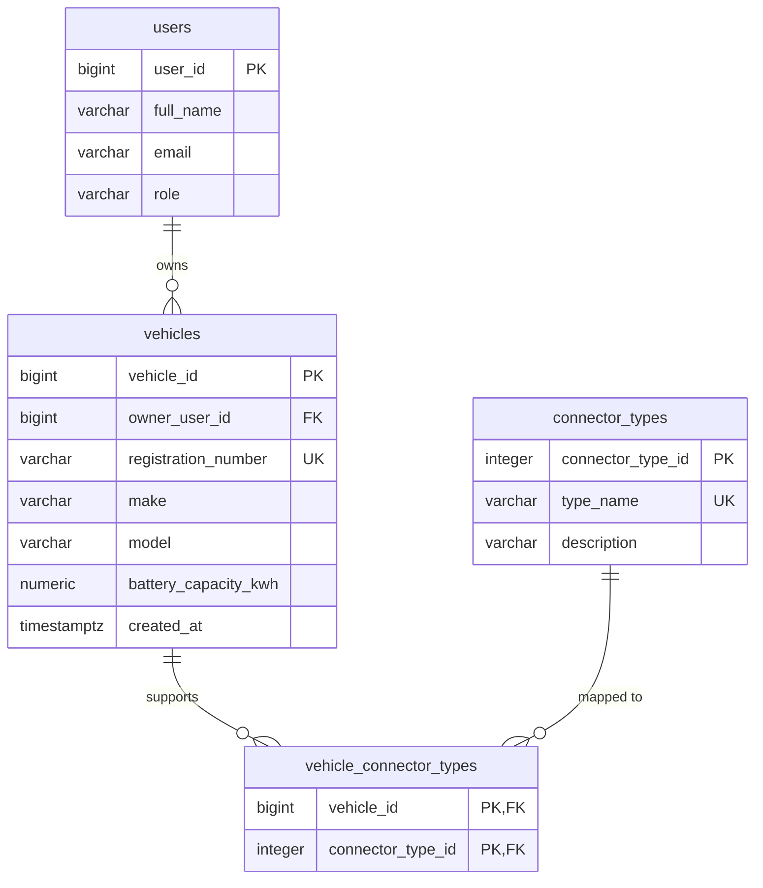
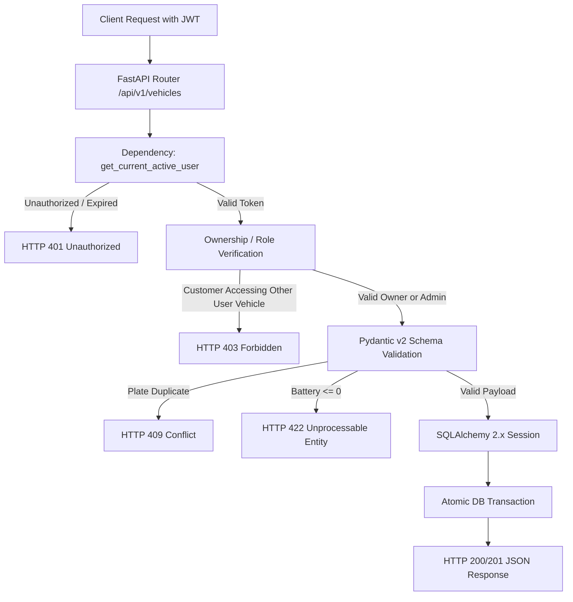

# Module 4 Report: Vehicle and Connector Management

**Project:** EV Charging Network Management System  
**Workspace:** `mh_dbms`  
**Database:** PostgreSQL 18 (`ev_charging_network`)  
**Status:** COMPLETED & VERIFIED (18/18 Module 4 Tests Passing, 43/43 Total Backend Tests Passing)  
**Date:** November 2026  

---

## 1. Executive Summary

Module 4 implements comprehensive **Vehicle and Connector Management** for the EV Charging Network Management System. This module bridges customer accounts with physical electric vehicles (EVs) and associates them with standardized charging connector port profiles (CCS-2, Type 2, CHAdeMO, GB/T).

Strict security and relational data integrity guarantees were established:
- **Ownership Binding:** Customers can register vehicles only under their own authenticated account. Untrusted `owner_user_id` inputs in request payloads are strictly ignored.
- **Data Isolation:** Customers are strictly isolated from inspecting or modifying vehicles owned by other customers (HTTP 403 Forbidden).
- **Physical Validation:** Unique registration plates (e.g., `MH12AB1234`) and strictly positive battery capacities (`battery_capacity_kwh > 0`) are validated client-side and enforced server-side.
- **Relational Atomic Transactions:** Assigning and replacing connector profiles utilizes transactional execution (`DELETE` + `INSERT` with rollback on failure), preventing partial or orphaned mappings.
- **PostgreSQL 18 Safety:** Zero mutations were applied to the pre-existing **14 database tables** or **54 dummy records**. All test suites executed against an isolated in-memory SQLite database.

---

## 2. Database Entities Used

The module leverages three pre-existing relational tables:



### Table Definitions & Constraints

| Table Name | Role | Primary Key | Foreign Keys / Constraints |
| :--- | :--- | :--- | :--- |
| `vehicles` | Stores registered electric vehicles | `vehicle_id` | `owner_user_id -> users(user_id)`, `UNIQUE(registration_number)`, `CHECK(battery_capacity_kwh > 0)` |
| `connector_types` | Standard EV charging ports | `connector_type_id` | `UNIQUE(type_name)` (CCS-2, Type 2, CHAdeMO, GB/T) |
| `vehicle_connector_types` | Junction table for many-to-many compatibility | `(vehicle_id, connector_type_id)` | Composite PK, Cascading deletion on vehicle removal |

---

## 3. API Endpoints Reference

All endpoints are hosted under `/api/v1`:

| Method | Endpoint | Access Role | Description |
| :--- | :--- | :--- | :--- |
| `GET` | `/api/v1/vehicles` | `CUSTOMER`, `OPERATOR`, `ADMIN` | Lists vehicles. Customers see only their own vehicles; Admin/Operator can view all or filter by `owner_user_id`. |
| `POST` | `/api/v1/vehicles` | `CUSTOMER`, `ADMIN` | Registers a new vehicle with optional initial connector types. Always binds to authenticated user. |
| `GET` | `/api/v1/vehicles/{vehicle_id}` | Owner, `ADMIN`, `OPERATOR` | Fetches details for a specific vehicle including battery specs and supported connector standards. |
| `PATCH` | `/api/v1/vehicles/{vehicle_id}` | Owner, `ADMIN` | Updates vehicle make, model, registration number, or battery capacity. Verifies uniqueness. |
| `GET` | `/api/v1/connectors` | Authenticated | Lists all network-supported EV connector standards (CCS-2, Type 2, CHAdeMO, GB/T). |
| `GET` | `/api/v1/vehicles/{vehicle_id}/connectors` | Owner, `ADMIN`, `OPERATOR` | Lists connector types currently mapped to a specific vehicle. |
| `PUT` | `/api/v1/vehicles/{vehicle_id}/connectors` | Owner, `ADMIN` | Replaces connector port mappings atomically in a single database transaction. |

---

## 4. Backend Implementation Architecture



### Key Technical Safeguards

1. **Owner Binding:**
   ```python
   new_vehicle = Vehicle(
       owner_user_id=current_user.user_id,  # Never trust client-provided owner IDs
       registration_number=reg_clean,
       make=vehicle_in.make.strip(),
       model=vehicle_in.model.strip(),
       battery_capacity_kwh=vehicle_in.battery_capacity_kwh
   )
   ```
2. **Atomic Connector Mapping Updates:**
   ```python
   try:
       db.query(VehicleConnectorType).filter(
           VehicleConnectorType.vehicle_id == vehicle_id
       ).delete(synchronize_session="fetch")

       for cid in unique_ids:
           db.add(VehicleConnectorType(vehicle_id=vehicle_id, connector_type_id=cid))

       db.commit()
       db.refresh(vehicle)
   except Exception as exc:
       db.rollback()
       raise HTTPException(status_code=500, detail="Transaction failed")
   ```

---

## 5. Frontend Implementation Architecture

The frontend is built using **React 18 + TypeScript**, styled with an emerald & cyan dark theme (`#0b1322` background, `#131e32` card background, `#10b981` accents):

1. **`VehiclesPage.tsx` (My Vehicles & Fleet Management):**
   - Displays interactive cards with license plate badge, battery pack metrics, and supported connector pills.
   - Real-time client-side search across Make, Model, and Registration Number.
   - Quick action buttons: *View Details* and *Edit / Ports*.
   - Responsive grid with loading spinners and clean empty state.
2. **`AddVehiclePage.tsx` (Vehicle Registration Form):**
   - Inputs for Registration Number, Make, Model, and Battery Capacity.
   - Integrated `ConnectorSelector` allowing multi-selection of charging ports.
   - Validates required fields, plate format, and positive numeric capacity.
3. **`EditVehiclePage.tsx` (Vehicle & Connector Editor):**
   - Pre-populates existing vehicle attributes and assigned port standards.
   - Synchronously updates vehicle specs and atomic connector mappings.
4. **`VehicleDetailsPage.tsx` (Vehicle Specifications):**
   - Detailed dashboard featuring battery pack capacity and estimated driving range (~6.5 km/kWh).
   - Connector standards breakdown explaining AC/DC capabilities and compatibility status.
   - Technical metadata (database ID, owner ID, registration timestamp).
5. **`ConnectorSelector.tsx` (Port Compatibility Component):**
   - Reusable card-based multi-select grid with green selection borders and standard descriptions.
6. **`Navbar.tsx` & `CustomerDashboard.tsx` Integration:**
   - Dedicated "My Vehicles" / "Fleet Vehicles" navigation links with role-based routing.
   - Quick Action buttons directly on the customer dashboard.

---

## 6. Test Suite and Verification Results

The automated test runner (`tests/run_module4_tests.py`) and pytest suite (`backend/tests/test_vehicles_module4.py`) executed 18 dedicated tests:

| Test Case Name | Target Requirement | Result |
| :--- | :--- | :---: |
| `test_list_connector_types` | Connector standards listing (`GET /connectors`) | **PASSED** |
| `test_list_connectors_unauthenticated` | Unauthenticated requests rejection (401) | **PASSED** |
| `test_register_vehicle_success` | Vehicle registration bound to current user | **PASSED** |
| `test_register_vehicle_duplicate_registration_rejected` | Duplicate plate rejection (409 Conflict) | **PASSED** |
| `test_register_vehicle_invalid_battery_capacity_rejected` | Battery capacity `<= 0` rejection (422) | **PASSED** |
| `test_register_vehicle_nonexistent_connector_rejected` | Invalid connector IDs rejection (400) | **PASSED** |
| `test_list_vehicles_customer_isolation` | Customer vehicle isolation verification | **PASSED** |
| `test_list_vehicles_admin_access` | Admin fleet-wide vehicle listing & filtering | **PASSED** |
| `test_get_vehicle_details_owner_success` | Owner vehicle detail inspection | **PASSED** |
| `test_get_vehicle_details_unauthorized_forbidden` | Cross-customer access rejection (403 Forbidden) | **PASSED** |
| `test_get_vehicle_details_not_found` | Non-existent vehicle lookup (404 Not Found) | **PASSED** |
| `test_update_vehicle_success` | Vehicle specification update | **PASSED** |
| `test_update_vehicle_duplicate_registration_rejected` | Update to already-registered plate (409) | **PASSED** |
| `test_update_vehicle_unauthorized_forbidden` | Unauthorized update rejection (403 Forbidden) | **PASSED** |
| `test_get_and_update_vehicle_connectors` | Connector mapping retrieval & replacement | **PASSED** |
| `test_update_vehicle_connectors_deduplication` | Duplicate connector ID input deduplication | **PASSED** |
| `test_update_vehicle_connectors_nonexistent_rejected` | Non-existent connector ID replacement (400) | **PASSED** |
| `test_update_vehicle_connectors_unauthorized_forbidden` | Unauthorized connector update rejection (403) | **PASSED** |

### Total Backend Test Suite Summary

- **Total Backend Tests:** **43 Passed, 0 Failed** (4.20s execution time)
  - Module 2 Tests: 5 Passed
  - Module 3 Tests: 17 Passed
  - Module 4 Tests: 18 Passed
  - Health Endpoint Tests: 3 Passed

---

## 7. Database Safety & Integrity Audit

The read-only PostgreSQL 18 database inspector (`database/inspector/db_inspector.py`) was executed immediately following all tests:

- **PostgreSQL 18 Service:** Running on `localhost:5432` (`ev_charging_network`)
- **Tables Verified:** **14 / 14**
- **Records Verified:** **54 / 54**
- **Database Status:** **100% UNTOUCHED & INTACT**

---

## 8. Commands to Run the Project Locally

### 1. Run Automated Tests
```powershell
# Run Module 4 tests specifically
C:\Users\kcm2k\AppData\Local\Programs\Python\Python313\python.exe tests/run_module4_tests.py

# Run full backend test suite (43 tests)
C:\Users\kcm2k\AppData\Local\Programs\Python\Python313\python.exe -m pytest backend/tests/ -v

# Inspect live PostgreSQL 18 database
C:\Users\kcm2k\AppData\Local\Programs\Python\Python313\python.exe database/inspector/db_inspector.py
```

### 2. Start the Backend API Server
```powershell
cd backend
C:\Users\kcm2k\AppData\Local\Programs\Python\Python313\python.exe -m uvicorn app.main:app --reload --host 127.0.0.1 --port 8000
```
Interactive OpenAPI Documentation: `http://127.0.0.1:8000/docs`

### 3. Start the Frontend Application
```powershell
cd frontend
npm run dev
```
Local Web Application: `http://localhost:5173`

