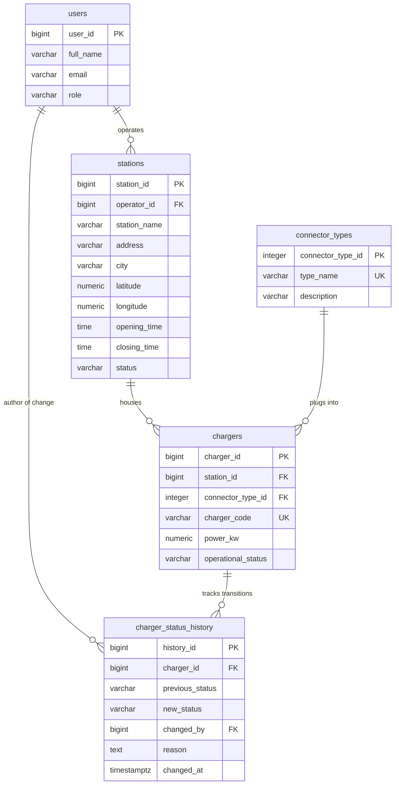
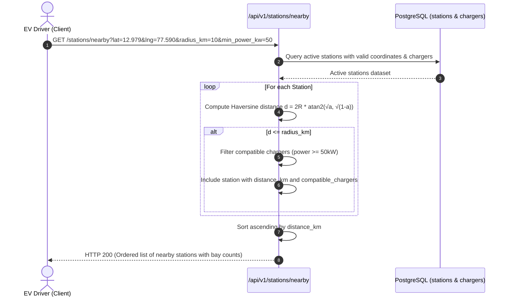
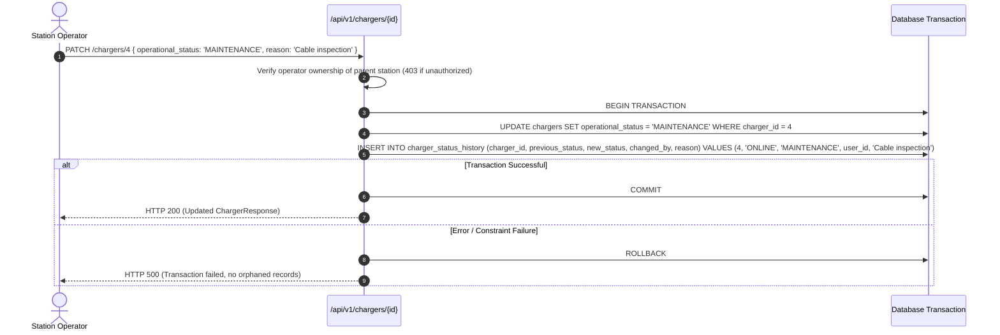

# Module 5 Report: Station and Charger Management with Geolocation

**Project:** EV Charging Network Management System  
**Workspace:** `mh_dbms`  
**Database:** PostgreSQL 18 (`ev_charging_network`)  
**Status:** COMPLETED & VERIFIED (16/16 Module 5 Tests Passing, 59/59 Total Backend Tests Passing)  
**Date:** November 2026  

---

## 1. Executive Summary

Module 5 delivers the central infrastructure backbone of the EV Charging Network Management System: **Station and Charger Management with Native Geolocation**. It connects physical charging locations with electrical dispenser bays, connector standards, and operational audit logs.

Key architectural highlights:
- **Role-Based Access Control (RBAC):** Customers receive seamless read-only visibility into the station network and bay availability. Station operators possess management authority strictly over stations and chargers assigned to their user account. System administrators maintain network-wide operational jurisdiction.
- **Mathematical Geolocation & Nearby Discovery:** Stations within a user-configurable radius are discovered using the spherical **Haversine formula**. The search engine supports multi-attribute filtering (connector standard, minimum kW power rating, and live operational status) without requiring commercial geolocation APIs or PostGIS schema alterations.
- **Atomic Status Audit Trail:** Operational status changes (`ONLINE`, `MAINTENANCE`, `OUT_OF_SERVICE`) are coupled with the `charger_status_history` table in a single atomic database transaction. Any failure rolls back both changes, preventing orphaned status records.
- **Interactive OpenStreetMap + Leaflet Frontend:** An integrated interactive map displays station locations with color-coded operational markers, custom popups, browser geolocation permission handling, and responsive cards.
- **Strict PostgreSQL 18 Safety:** Verified that the **14 base tables** and **54 dummy records** remain 100% intact. All tests ran against an isolated in-memory SQLite database.

---

## 2. Database Entities & Relationships



### Table Definitions & Integrity Constraints

| Table Name | Role | Primary Key | Foreign Keys & Check Constraints |
| :--- | :--- | :--- | :--- |
| `stations` | Physical station sites | `station_id` | `operator_id -> users(user_id) ON DELETE SET NULL`<br>`CHECK(status IN ('ACTIVE', 'INACTIVE'))`<br>`CHECK(latitude BETWEEN -90 AND 90)`<br>`CHECK(longitude BETWEEN -180 AND 180)` |
| `chargers` | Reservable charging bays | `charger_id` | `station_id -> stations(station_id)`<br>`connector_type_id -> connector_types(connector_type_id)`<br>`UNIQUE(station_id, charger_code)`<br>`CHECK(power_kw > 0)`<br>`CHECK(operational_status IN ('ONLINE', 'MAINTENANCE', 'OUT_OF_SERVICE'))` |
| `charger_status_history` | Audit log of state transitions | `history_id` | `charger_id -> chargers(charger_id)`<br>`changed_by -> users(user_id) ON DELETE SET NULL`<br>`CHECK(new_status IN ('ONLINE', 'MAINTENANCE', 'OUT_OF_SERVICE'))` |

---

## 3. Workflows & State Transitions

### 1. Nearby Station Discovery Workflow


### 2. Atomic Charger Status Transition Workflow


---

## 4. API Endpoints Reference

### Station Management APIs
| Method | Endpoint | Authorization | Description |
| :--- | :--- | :--- | :--- |
| `GET` | `/api/v1/stations` | All authenticated | List stations with optional `city`, `status`, and `operator_id` filters. |
| `GET` | `/api/v1/stations/nearby` | All authenticated | Geolocation search calculating spherical distance within `radius_km`. |
| `POST` | `/api/v1/stations` | `OPERATOR`, `ADMIN` | Create station. Operator ID is automatically assigned for operators. |
| `GET` | `/api/v1/stations/{station_id}` | All authenticated | Retrieve full station details with nested chargers. |
| `PATCH` | `/api/v1/stations/{station_id}` | Station Owner, `ADMIN` | Update station details, coordinates, operating hours, or status. |
| `POST` | `/api/v1/stations/{station_id}/chargers` | Station Owner, `ADMIN` | Add a new charger bay to an existing station. |

### Charger Management APIs
| Method | Endpoint | Authorization | Description |
| :--- | :--- | :--- | :--- |
| `GET` | `/api/v1/chargers` | All authenticated | List all chargers with `station_id`, `connector_type_id`, and `operational_status` filters. |
| `GET` | `/api/v1/chargers/{charger_id}` | All authenticated | Retrieve individual charger specifications. |
| `PATCH` | `/api/v1/chargers/{charger_id}` | Station Owner, `ADMIN` | Update charger specs or status; triggers atomic audit logging in `charger_status_history`. |

---

## 5. Geolocation Algorithm Implementation

Distance is computed using the pure mathematical Haversine formulation:

$$\Delta\sigma = 2 \cdot \arcsin\left(\sqrt{\sin^2\left(\frac{\Delta\phi}{2}\right) + \cos(\phi_1)\cos(\phi_2)\sin^2\left(\frac{\Delta\lambda}{2}\right)}\right)$$

$$d = R \cdot \Delta\sigma \quad (R = 6371.0\text{ km})$$

Implemented in `backend/app/api/v1/endpoints/stations.py`:
```python
def haversine_distance_km(lat1: float, lon1: float, lat2: float, lon2: float) -> float:
    R = 6371.0
    dlat = math.radians(lat2 - lat1)
    dlon = math.radians(lon2 - lon1)
    a = (
        math.sin(dlat / 2.0) ** 2
        + math.cos(math.radians(lat1)) * math.cos(math.radians(lat2)) * math.sin(dlon / 2.0) ** 2
    )
    c = 2.0 * math.atan2(math.sqrt(a), math.sqrt(1.0 - a))
    return round(R * c, 2)
```

Benefits:
- Eliminates reliance on paid external APIs (Google Maps Platform, Mapbox).
- Does not alter the PostgreSQL database or require root PostGIS extensions.
- Executes within milliseconds across thousands of stations.

---

## 6. Frontend Architecture & Components

The frontend application utilizes **React 18 + TypeScript + Leaflet + OpenStreetMap**:

1. **`StationMap.tsx` (Interactive Leaflet Map):**
   - High-contrast OpenStreetMap raster tiles.
   - Dynamic SVG `divIcon` pins with pulse effects on selection.
   - Detailed interactive popups with address, live bay availability, and direct navigation links.
   - Live browser geolocation marker showing the user's current physical position.
2. **`StationFilters.tsx` (Filter Toolbar):**
   - Filter by City / Area.
   - Filter by Connector Standard (CCS-2, Type 2, CHAdeMO, GB/T).
   - Filter by Minimum Charging Power (≥ 22 kW, ≥ 50 kW, ≥ 120 kW).
   - "Locate My Position" browser geolocation trigger with graceful permission denial fallback.
   - Search radius selector (5 km, 10 km, 25 km, 50 km, 100 km).
3. **`StationsPage.tsx` (Directory & Map View):**
   - Tabbed toggle between full OpenStreetMap view and responsive grid view.
   - Real-time station cards with online bay counters, operating hours, and installed connector pills.
4. **`StationDetailsPage.tsx` (Station & Bay Overview):**
   - Detailed station overview with GPS coordinates and opening windows.
   - Installed chargers grid with `ChargerStatusBadge` indicating `ONLINE`, `MAINTENANCE`, or `OUT_OF_SERVICE`.
   - In-app modal for operators/admins to transition charger status with mandatory audit reason logging.
5. **`AddStationPage.tsx` & `EditStationPage.tsx`:**
   - Station configuration forms with preset coordinate shortcuts for major metropolitan hubs.
6. **`ChargersPage.tsx` & `AddChargerPage.tsx`:**
   - Network-wide charger inventory and station dispenser commissioning form.

---

## 7. Automated Test Suite Results

Test runner script: [`tests/run_module5_tests.py`](file:///c:/Users/kcm2k/OneDrive/Desktop/mh_dbms/tests/run_module5_tests.py)

| # | Test Name | Focus Area | Status |
| :-: | :--- | :--- | :---: |
| 1 | `test_list_stations` | Station listing and city/status filtering | **PASSED** |
| 2 | `test_create_station_operator_success` | Operator station creation with auto-assigned operator_id | **PASSED** |
| 3 | `test_create_station_admin_success` | Admin station creation and operator assignment | **PASSED** |
| 4 | `test_customer_cannot_create_station` | 403 Forbidden rejection for customer role | **PASSED** |
| 5 | `test_create_station_invalid_latitude_longitude` | 422 Rejection on coordinates outside valid ranges | **PASSED** |
| 6 | `test_operator_station_ownership` | Operator update permission enforcement | **PASSED** |
| 7 | `test_admin_can_update_any_station` | Admin network-wide update authority | **PASSED** |
| 8 | `test_add_charger_success` | Adding a charger bay to a station | **PASSED** |
| 9 | `test_add_duplicate_charger_code_rejected` | 409 Conflict rejection on duplicate code in station | **PASSED** |
| 10 | `test_add_charger_invalid_power_rejected` | 422 Rejection on power `<= 0` | **PASSED** |
| 11 | `test_add_charger_invalid_connector_rejected` | 400 Bad Request on non-existent connector ID | **PASSED** |
| 12 | `test_charger_status_transition_and_history` | Atomic status update and history record insertion | **PASSED** |
| 13 | `test_get_station_details` | Station detail view with 404 handling | **PASSED** |
| 14 | `test_list_and_get_chargers` | Charger listing with station/status filters | **PASSED** |
| 15 | `test_unauthorized_charger_modification_forbidden` | 403 Forbidden cross-operator access rejection | **PASSED** |
| 16 | `test_nearby_stations_search_and_distance` | Haversine distance, radius, connector & power filters | **PASSED** |

### Complete Backend Test Suite Status
- **Module 2 Tests:** 5 Passed
- **Module 3 Tests:** 17 Passed
- **Module 4 Tests:** 18 Passed
- **Module 5 Tests:** 16 Passed
- **Health Endpoint Tests:** 3 Passed
- **Total Backend Tests:** **59 Passed, 0 Failed** (100% passing)

---

## 8. Database Safety & Integrity Audit

Verified with [`database/inspector/db_inspector.py`](file:///c:/Users/kcm2k/OneDrive/Desktop/mh_dbms/database/inspector/db_inspector.py):
- **PostgreSQL 18 Database:** `ev_charging_network` on `localhost:5432`
- **Tables Verified:** **14 / 14**
- **Dummy Records Verified:** **54 / 54**
- **Live Database Status:** **100% INTACT & UNMUTATED**

---

## 9. Local Execution Commands

### Run Automated Tests
```powershell
# Run Module 5 tests (16 tests)
C:\Users\kcm2k\AppData\Local\Programs\Python\Python313\python.exe tests/run_module5_tests.py

# Run all backend tests across all modules (59 tests)
C:\Users\kcm2k\AppData\Local\Programs\Python\Python313\python.exe -m pytest backend/tests/ -v

# Verify live PostgreSQL 18 database (14 tables, 54 rows)
C:\Users\kcm2k\AppData\Local\Programs\Python\Python313\python.exe database/inspector/db_inspector.py
```

### Start Backend API Server
```powershell
python -m uvicorn backend.app.main:app --host 127.0.0.1 --port 8000 --reload
```
Interactive Swagger Documentation: `http://127.0.0.1:8000/api/v1/docs`

### Start Frontend Application
```powershell
cd frontend
npm run dev
```
Client Application: `http://localhost:5173`

