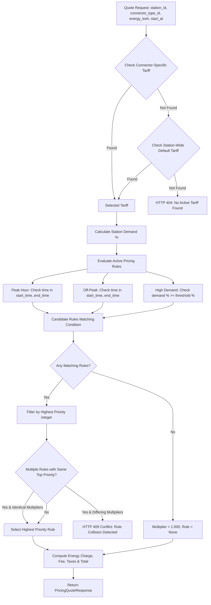

# Module 6 Report: Tariffs and Dynamic Pricing Calculation Engine

**Project:** EV Charging Network Management System  
**Workspace:** `mh_dbms`  
**Database:** PostgreSQL 18 (`ev_charging_network`)  
**Status:** COMPLETED & VERIFIED (19/19 Module 6 Tests Passing, 78/78 Total Backend Tests Passing)  
**Date:** November 2026  

---

## 1. Executive Summary

Module 6 delivers the financial intelligence and dynamic tariff calculation engine of the EV Charging Network Management System: **Tariffs and Dynamic Pricing Calculation Engine**. It implements a non-destructive, read-only calculation engine capable of real-time demand sensing, peak/off-peak schedule matching, connector-specific pricing hierarchies, conflict detection, and itemized billing estimations.

Key architectural highlights:
- **Tariff Hierarchy & Priority Resolution:** Automatically resolves tariffs by preferring connector-specific rates (e.g. CCS-2 DC fast charging) before falling back to station-wide baseline tariffs.
- **Dynamic Pricing Rules Engine:** Dynamically evaluates time-of-use conditions (`PEAK_HOUR` surge, `OFF_PEAK` discount) and real-time station demand conditions (`HIGH_DEMAND` surge) against user-defined priorities and thresholds.
- **Deterministic Multiplier Collision Prevention:** When multiple applicable rules tie with identical top priority but divergent price multipliers, the engine detects this ambiguity and rejects execution with `HTTP 409 Conflict`, guaranteeing deterministic billing without hidden financial drift.
- **Station Demand Calculation with Deduplication:** Real-time demand is computed as the percentage of online chargers currently engaged in active charging sessions or overlapping confirmed/pending reservations. Chargers with concurrent sessions and reservations are deduplicated to avoid artificial demand inflation.
- **Pure Calculation Engine (Read-Only):** The quote endpoint (`POST /api/v1/pricing/quote`) evaluates pricing without modifying the database state or reserving charger bays.
- **Historical Price Integrity Blueprint:** Formulated a formal change proposal in `database/schema/proposed_session_tariff_extension.sql` to snapshot session rates before invoice generation, while confirming that existing `invoices` remain fully immutable.
- **Interactive Frontend UI:** Built a full suite of React/TypeScript components including an interactive Dynamic Pricing Calculator with real-time feedback, price breakdown cards, tariff management, and dynamic rule configurators.
- **Database Safety Guarantees:** 100% adherence to database safety rules. Zero `DROP`, `TRUNCATE`, `ALTER`, or migration commands were executed against the live PostgreSQL 18 database. All 14 tables and 54 original dummy records remain intact.

---

## 2. Mathematical Model & Calculation Specifications

### 2.1 Dynamic Station Demand Calculation

$$\text{demand\_percentage} = \left( \frac{|\mathcal{C}_{\text{occupied}}|}{|\mathcal{C}_{\text{online}}|} \right) \times 100$$

Where:
- $\mathcal{C}_{\text{online}} = \{ c \in \text{Chargers}(\text{station}) \mid c.\text{operational\_status} \neq \text{'OUT\_OF\_SERVICE'} \}$
- If $|\mathcal{C}_{\text{online}}| = 0$, demand is defined as $0.00\%$.
- $\mathcal{C}_{\text{occupied}} = \mathcal{C}_{\text{active\_sessions}} \cup \mathcal{C}_{\text{overlapping\_reservations}}$, where:
  - $\mathcal{C}_{\text{active\_sessions}} = \{ c \in \mathcal{C}_{\text{online}} \mid \exists s \in \text{Sessions}, s.\text{status} = \text{'ACTIVE'} \land s.\text{charger\_id} = c.\text{charger\_id} \}$
  - $\mathcal{C}_{\text{overlapping\_reservations}} = \{ c \in \mathcal{C}_{\text{online}} \mid \exists r \in \text{Reservations}, r.\text{status} \in \{\text{'CONFIRMED'}, \text{'PENDING'}\} \land r.\text{start\_at} < \text{window\_end} \land r.\text{end\_at} > \text{window\_start} \}$
- The set union ($\cup$) guarantees that chargers having both an active session and a valid overlapping reservation are never double-counted.

### 2.2 Financial Billing Calculations

All currency values are calculated in Python `Decimal` using standard financial half-up rounding (`ROUND_HALF_UP` to 2 decimal places):

1. **Effective Rate per kWh:**
   $$\text{effective\_rate} = \text{round\_2}(\text{base\_price\_per\_kwh} \times \text{multiplier})$$

2. **Energy Charge:**
   $$\text{energy\_charge} = \text{round\_2}(\text{estimated\_energy\_kwh} \times \text{effective\_rate})$$

3. **Subtotal:**
   $$\text{subtotal} = \text{round\_2}(\text{energy\_charge} + \text{session\_fee})$$

4. **Tax Amount (GST):**
   $$\text{tax\_amount} = \text{round\_2}\left(\text{subtotal} \times \frac{\text{tax\_rate\_percent}}{100}\right)$$

5. **Total Payable Amount:**
   $$\text{total\_amount} = \text{round\_2}(\text{subtotal} + \text{tax\_amount})$$

---

## 3. Dynamic Rule Hierarchy & Resolution Engine



---

## 4. API Endpoints Specification

### 4.1 Tariff Management APIs (`/api/v1/tariffs`)

| Method | Endpoint | Access / RBAC | Description |
|---|---|---|---|
| `GET` | `/api/v1/tariffs` | Authenticated (All Roles) | List tariffs with optional filters: `station_id`, `connector_type_id`, `active_at`. |
| `POST` | `/api/v1/tariffs` | Operator (Own Station) / Admin | Create a new base tariff. Validates non-negative rates, dates, and rejects temporal overlaps. |
| `GET` | `/api/v1/tariffs/{tariff_id}` | Authenticated (All Roles) | Retrieve tariff details and associated pricing rules. |
| `PATCH` | `/api/v1/tariffs/{tariff_id}` | Operator (Own Station) / Admin | Update rates, session fee, tax, or validity window with overlap safety checks. |

### 4.2 Dynamic Pricing Rules APIs (`/api/v1/pricing-rules`)

| Method | Endpoint | Access / RBAC | Description |
|---|---|---|---|
| `GET` | `/api/v1/pricing-rules` | Authenticated (All Roles) | List dynamic rules. Filter by `tariff_id`, `rule_type`, `is_active`. |
| `POST` | `/api/v1/pricing-rules` | Operator (Own Station) / Admin | Create rule (`PEAK_HOUR`, `OFF_PEAK`, `HIGH_DEMAND`) with schedule, threshold, multiplier & priority. |
| `GET` | `/api/v1/pricing-rules/{rule_id}` | Authenticated (All Roles) | Get rule details. |
| `PATCH` | `/api/v1/pricing-rules/{rule_id}` | Operator (Own Station) / Admin | Update rule parameters, multiplier, priority, or active status. |

### 4.3 Pricing Engine & Demand APIs (`/api/v1/pricing`)

| Method | Endpoint | Access / RBAC | Description |
|---|---|---|---|
| `POST` | `/api/v1/pricing/quote` | Authenticated (All Roles) | Simulate real-time dynamic quote. Pure read-only calculation without DB state mutation. |
| `GET` | `/api/v1/pricing/demand` | Authenticated (All Roles) | Query station charger utilization and demand % for an arbitrary time window. |

---

## 5. Historical Price Integrity Analysis

### 5.1 Analysis of Current Database Design
Inspection of the existing PostgreSQL 18 database revealed:
1. **Invoices Table Immutability:** The pre-existing `invoices` table already stores historical financial snapshots:
   - `energy_kwh`
   - `price_per_kwh`
   - `session_fee`
   - `tax_rate_percent`
   - `energy_charge`
   - `tax_amount`
   - `total_amount`
   Once an invoice is issued, these values remain permanent and immune to subsequent tariff edits.
2. **Pre-Invoicing Audit Gap:** Between the moment a driver begins charging and when the final invoice is compiled, dynamic pricing rules (e.g., peak-hour surge transition) or operator tariff changes could cause pricing recalculation drift if not explicitly locked on the session record.

### 5.2 Architectural Proposal (`database/schema/proposed_session_tariff_extension.sql`)
To preserve audit integrity before invoice compilation, a non-destructive SQL proposal was drafted:
```sql
ALTER TABLE charging_sessions
    ADD COLUMN IF NOT EXISTS applied_rate_per_kwh NUMERIC(10, 2),
    ADD COLUMN IF NOT EXISTS applied_rule_id BIGINT REFERENCES pricing_rules(rule_id) ON DELETE SET NULL,
    ADD COLUMN IF NOT EXISTS locked_session_fee NUMERIC(10, 2) DEFAULT 0.00,
    ADD COLUMN IF NOT EXISTS locked_tax_rate_percent NUMERIC(5, 2) DEFAULT 0.00;
```
> **Safety Guarantee:** In strict adherence to workspace directives, this script was created as documentation only and **was NOT executed** against PostgreSQL 18.

---

## 6. Frontend UI Implementation

The frontend incorporates full pricing management and simulation tools:
1. `frontend/src/types/tariff.ts`: Strongly typed interfaces for tariffs, rules, quotes, and demand data.
2. `frontend/src/services/pricing.ts`: Client API service communicating with `/tariffs`, `/pricing-rules`, and `/pricing/quote`.
3. `frontend/src/components/pricing/PriceBreakdown.tsx`: Visual breakdown card presenting base price, dynamic surge badge, effective rate per kWh, energy fee, taxes, total, and live station demand gauge.
4. `frontend/src/components/pricing/PricingCalculator.tsx`: Interactive pricing calculator supporting station and connector selection, energy slider (1–100 kWh), quick presets, and instant recalculation.
5. `frontend/src/pages/PricingCalculatorPage.tsx`: Dedicated user-facing estimation page.
6. `frontend/src/pages/TariffManagementPage.tsx`: Operator/Admin tariff dashboard.
7. `frontend/src/pages/AddTariffPage.tsx`: Form to configure station baseline and connector tariffs.
8. `frontend/src/pages/PricingRulesPage.tsx`: Overview of active dynamic surge/discount rules with priority levels.
9. `frontend/src/pages/AddPricingRulePage.tsx`: Form to attach dynamic rules to tariffs.
10. `frontend/src/components/Navbar.tsx`: Added quick-navigation links for "⚡ Pricing" and "Tariffs".

---

## 7. Verification & Automated Test Results

### 7.1 Module 6 Test Suite (`backend/tests/test_pricing_module6.py`)
All 19 test scenarios passed successfully:

| # | Test Scenario | Result |
|---|---|---|
| 1 | `test_tariff_creation_and_listing_admin_operator` | PASSED |
| 2 | `test_customer_forbidden_from_creating_or_updating_tariff` | PASSED |
| 3 | `test_operator_cannot_manage_other_operator_station_tariff` | PASSED |
| 4 | `test_tariff_temporal_overlap_rejection` | PASSED |
| 5 | `test_tariff_invalid_constraints` | PASSED |
| 6 | `test_pricing_rule_creation_and_listing` | PASSED |
| 7 | `test_pricing_rule_invalid_parameters` | PASSED |
| 8 | `test_quote_base_tariff_standard_rate` | PASSED |
| 9 | `test_quote_connector_specific_tariff_precedence` | PASSED |
| 10 | `test_quote_station_wide_fallback` | PASSED |
| 11 | `test_quote_peak_hour_rule_activation` | PASSED |
| 12 | `test_quote_off_peak_rule_activation` | PASSED |
| 13 | `test_quote_high_demand_rule_activation` | PASSED |
| 14 | `test_quote_high_demand_threshold_not_met` | PASSED |
| 15 | `test_quote_rule_priority_resolution` | PASSED |
| 16 | `test_quote_rule_collision_detection` | PASSED |
| 17 | `test_quote_expired_or_future_tariff_rejection` | PASSED |
| 18 | `test_quote_with_zero_kwh` | PASSED |
| 19 | `test_station_demand_calculation_and_double_counting_avoidance` | PASSED |

### 7.2 Full Regression Test Suite
- **Total Backend Tests:** 78 Passed, 0 Failed (Auth, Database Core, Health, Vehicles, Connectors, Stations, Chargers, Tariffs, Pricing Rules, Pricing Engine).
- **Frontend TypeScript Build:** 0 compilation errors (`tsc --noEmit` exited with code 0).
- **PostgreSQL 18 DB Verification:** 14/14 tables and 54/54 original seed records verified untouched.
- **Log Files Generated:**
  - `tests/test_results/module6_test_results.log`
  - `results/test_results/module6_test_results.log`

