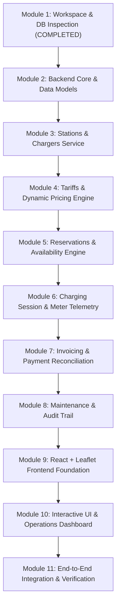

# EV Charging Network Management System - Modular Implementation Roadmap

**Workspace Root:** `mh_dbms`  
**Database:** PostgreSQL 18 (`ev_charging_network`)  
**Stack:** FastAPI + Python | React + TypeScript | Leaflet + OpenStreetMap  

---

## Architecture Principles
1. **Module-by-Module Progression:** Each module is developed, isolated, and unit/integration tested before progressing to subsequent modules.
2. **Zero Destructive Database Operations:** The existing 14 tables and 54 sample records are immutable ground-truth. No drops, truncates, or schema rewrites.
3. **Defense-in-Depth Security:** Database credentials remain strictly confined to environment variables (`.env`). No plaintext passwords in code, logs, or documentation.

---

## Module Breakdown

---

### Module 1: Workspace Setup, Configuration & Database Audit *(Status: COMPLETED)*
- [x] Inspect workspace `mh_dbms`.
- [x] Establish modular folder architecture (`backend`, `frontend`, `database`, `docs`, `tests`).
- [x] Create `.env.example`, `.env` template, and `.gitignore`.
- [x] Build and execute READ-ONLY PostgreSQL inspection tool (`database/inspector/db_inspector.py`).
- [x] Verify all 14 tables and 54 dummy records in PostgreSQL 18.
- [x] Document comparison between ER diagram and physical relational schema (`docs/ER_DIAGRAM_COMPARISON.md`).
- [x] Record test execution evidence in `tests/test_results/`.

---

### Module 2: Backend Core, Database Connectivity & ORM Models
- [ ] Configure `app.core.config.Settings` using Pydantic Settings.
- [ ] Implement robust database session management (`app.core.database`) with connection pooling and graceful error handling.
- [ ] Construct SQLAlchemy ORM models mirroring all 14 tables without altering existing database structures.
- [ ] Create Pydantic v2 validation schemas (`app.schemas`) for all entity inputs and outputs.
- [ ] Test database session lifecycle with automated health-check endpoints.

---

### Module 3: Stations & Chargers Directory API (with Geolocation)
- [ ] Implement CRUD and query services for `stations`, `chargers`, and `connector_types`.
- [ ] Build REST endpoints:
  - `GET /api/v1/stations`: List stations with filtering by city, status, and connector standard.
  - `GET /api/v1/stations/{id}`: Detailed view including chargers and active operational statuses.
  - `GET /api/v1/chargers`: Charger inventory with power ratings (kW) and availability.
- [ ] Implement bounding-box and radius queries for map viewport integration.
- [ ] Module test verification.

---

### Module 4: Tariffs & Dynamic Pricing Calculation Engine
- [ ] Implement tariff resolution logic: match station, connector type, and current temporal validity.
- [ ] Build pricing rule evaluation engine:
  - Time-of-day multipliers (`PEAK_HOUR`, `OFF_PEAK`).
  - Demand-based multiplier (`HIGH_DEMAND` threshold checks).
- [ ] Build `POST /api/v1/tariffs/estimate`: Real-time cost estimator endpoint given station, energy kWh, and start time.
- [ ] Unit tests for multi-tier pricing calculation.

---

### Module 5: Reservations & Conflict Detection Module
- [ ] Implement slot availability checking ensuring no overlapping bookings on the same `charger_id`.
- [ ] Endpoints for reservation lifecycle:
  - `POST /api/v1/reservations`: Create booking with conflict validation (`end_at > start_at`).
  - `GET /api/v1/reservations`: Filter by user, charger, or status (`CONFIRMED`, `CANCELLED`, etc.).
  - `PATCH /api/v1/reservations/{id}/cancel`: Cancellation workflow.
- [ ] Reservation concurrency and collision tests.

---

### Module 6: Charging Sessions & Telemetry Simulation
- [ ] Support both reservation-linked sessions and ad-hoc / walk-in sessions.
- [ ] Endpoints:
  - `POST /api/v1/sessions/start`: Initialize charging session, set status to `ACTIVE`.
  - `POST /api/v1/sessions/{id}/stop`: Complete session, capture meter readings (`meter_end_kwh`).
  - Automatic invoice calculation hook on session completion.
- [ ] Verification tests for CHECK constraint adherence.

---

### Module 7: Invoicing & Payment Reconciliation
- [ ] Invoicing services: compute energy charges, session fees, taxes, and grand total.
- [ ] Endpoints:
  - `GET /api/v1/invoices/{id}`: Structured invoice details.
  - `POST /api/v1/payments`: Process simulated UPI, Card, or Demo payments.
  - Automatic invoice status update (`PAID`) upon successful payment transaction.
- [ ] Financial reconciliation tests.

---

### Module 8: Equipment Maintenance & Audit History
- [ ] Fault reporting endpoints for operators and customers (`POST /api/v1/maintenance`).
- [ ] Maintenance work-order lifecycle management (`OPEN` -> `IN_PROGRESS` -> `RESOLVED`).
- [ ] Append-only audit logging in `charger_status_history` whenever operational status transitions occur.
- [ ] Maintenance and audit trail test cases.

---

### Module 9: React + TypeScript + Leaflet Frontend Foundation
- [ ] Initialize Vite + React 18 + TypeScript environment inside `frontend/`.
- [ ] Configure OpenStreetMap tile layer and Leaflet map container.
- [ ] Build reusable UI components: Station Markers, Charger Status Badges, Power Indicators.
- [ ] Connect frontend API client with Axios and typed response schemas.

---

### Module 10: Interactive UI & Operations Dashboard
- [ ] Interactive station map with search, city filter, and connector type filter.
- [ ] Station detail modal with live charger availability.
- [ ] Slot booking & reservation flow dialog.
- [ ] Active charging session live meter simulator widget.
- [ ] Operator management view: maintenance ticket logger and revenue charts.

---

### Module 11: End-to-End System Testing & Documentation Delivery
- [ ] Run complete automated regression test suite across backend API and database.
- [ ] Verify frontend build (`npm run build`).
- [ ] Generate system architecture walkthrough and screenshots.
- [ ] Final project delivery report.

