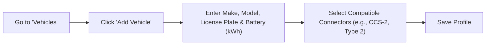

# User Manual: EV Charging Network Management System

**Welcome to the EV Charging Network Management System.**  
This guide provides step-by-step instructions for all three platform roles:
1. **EV Drivers (Customers)**
2. **Station Operators**
3. **Platform Administrators**

---

## 1. Getting Started & Authentication

### 1.1 Accessing the Application
- Open your modern web browser (Chrome, Firefox, Edge, Safari).
- Navigate to: **`http://localhost:5173`**

### 1.2 Registration & Login
1. **Registering an Account:**
   - Click **"Register"** on the top navigation bar or login screen.
   - Enter your Full Name, Email, Phone Number, and a secure password.
   - Click **"Sign Up"**. Your account is created instantly as an active **Customer**.
2. **Logging In:**
   - Enter your registered email and password.
   - *Quick Demo Access:* For testing, quick-fill buttons are available on the login page:
     - **Customer:** `customer1@example.com` / `CustomerPass123!`
     - **Operator:** `operator1@example.com` / `OperatorPass123!`
     - **Admin:** `admin1@example.com` / `AdminPass123!`
   - Click **"Sign In"**. You are automatically redirected to your role-specific dashboard.

---

## 2. EV Driver (Customer) Guide

### 2.1 Managing Your Electric Vehicles
Before charging, you must register your electric vehicle and select its compatible charging ports:

1. Navigate to **"Vehicles"** from the top menu.
2. Click **"+ Add Vehicle"**.
3. Fill in:
   - **Make & Model:** e.g., *Tata Nexon EV* or *Hyundai Ioniq 5*
   - **Year:** e.g., *2024*
   - **License Plate:** e.g., *KA-01-EQ-9988*
   - **Battery Capacity (kWh):** e.g., *40.5*
4. In the **Connector Compatibility** section, check the ports your vehicle physically accepts (e.g., **CCS-2** for DC fast charging, **Type 2 AC** for slow charging).
5. Click **"Save Vehicle"**.

---

### 2.2 Finding Charging Stations
1. Click **"Stations"** in the navigation bar.
2. **Interactive Map View:**
   - Stations are marked with interactive pins on the OpenStreetMap.
   - Green markers indicate stations with currently available chargers.
   - Click any pin to view station operating hours, address, and live bay availability.
3. **Proximity Search:**
   - Enter your city or click **"Use My Location"**.
   - Adjust the radius slider (e.g., 5 km, 15 km, 25 km) to discover nearby hubs.
4. Click **"View Station"** to view all installed charging bays and real-time statuses.

---

### 2.3 Dynamic Price Estimator
1. Click **"Pricing Calculator"** in the menu.
2. Select your desired charging station and bay.
3. Input the energy you plan to consume (e.g., *25 kWh*).
4. Select the planned time of arrival.
5. The calculator provides a dynamic quote breakdown:
   - **Base Rate:** Tariff per kWh
   - **Dynamic Multiplier:** Peak surge ($1.25\times$) or Off-peak discount ($0.85\times$)
   - **Session Connection Fee**
   - **Taxes (18% GST)**
   - **Total Estimated Price**

---

### 2.4 Reserving a Charging Slot
To guarantee equipment availability upon arrival:
1. Navigate to **"Reservations"** and click **"+ Book Slot"**.
2. Select your registered vehicle and the target station.
3. Pick an available charging bay supporting your vehicle's connector.
4. Choose your **Start Time** and **End Time** (e.g., `14:00` to `15:00`).
5. Click **"Confirm Reservation"**.
   > [!NOTE]
   > The reservation engine employs half-open time interval logic. If a previous driver's slot ends at `14:00`, you can book starting exactly at `14:00`. If someone already holds an overlapping window, the system prevents double-booking and suggests alternative times.

---

### 2.5 Charging Your EV
1. Arrive at the station bay during your scheduled reservation (or as a walk-in).
2. Go to **"Sessions"** and click **"Start Session"**.
3. Select your charger and vehicle. If you have an active reservation, select it to link your booking.
4. The screen reads the physical meter baseline (e.g., `150.20 kWh`).
5. Click **"Start Charging"**. The charger bay locks into `CHARGING` status.
6. **Live Telemetry:** While charging, you can view elapsed time, estimated kWh transferred, and live session status.
7. **Ending Session:**
   - Click **"Complete Session"**.
   - Verify final meter reading (e.g., `178.70 kWh`).
   - The system calculates net energy ($28.50\text{ kWh}$) and automatically releases the charger bay back to `ONLINE`.

---

### 2.6 Reviewing Invoices & Paying
1. Once your session finishes, an invoice is generated automatically.
2. Go to **"Invoices"** and click on the newly generated invoice.
3. Review the itemized charges:
   - Energy Charge
   - Dynamic Multipliers applied
   - Session Fee
   - GST (18%)
4. Click **"Pay Now"**.
5. Choose your payment method (**UPI**, **Card**, or **Demo Checkout**).
6. Click **"Confirm Payment"**.
   - Upon success, the invoice updates to **PAID** and a printable tax receipt is generated.
   - If payment fails, the invoice safely remains **UNPAID** with a failure log, allowing you to retry with another method without losing your billing record.

---

## 3. Station Operator Guide

### 3.1 Operator Dashboard
Station operators have access to the **Operator Dashboard**:
- **Fleet Overview:** Total stations assigned, total chargers, bays currently in use (`CHARGING`), and bays in `MAINTENANCE`.
- **Active Sessions:** Live telemetry monitoring of vehicles currently drawing power.

### 3.2 Managing Stations & Chargers
1. Click **"Stations"** $\rightarrow$ select your station $\rightarrow$ click **"Edit Station"**.
2. Update opening hours, address, or station operational status.
3. **Commissioning New Chargers:**
   - Click **"+ Add Charger"**.
   - Select physical connector type (CCS-2, Type 2, etc.) and maximum rated kW capacity (e.g., 60 kW, 120 kW).
   - Enter physical identifier (e.g., `BAY-01-FAST`).

### 3.3 Submitting Maintenance Tickets & Bay Locking
When equipment is damaged or malfunctioning:
1. Navigate to **"Maintenance"** in the top navigation.
2. Click **"+ Report Issue"**.
3. Select the affected charger, describe the issue (e.g., *Cable damage*, *Screen unresponsive*), and set priority (`LOW`, `MEDIUM`, `HIGH`, `CRITICAL`).
4. **Assigning a Technician:**
   - Select an assigned certified operator or technician.
   - Click **"Assign Work Order"**.
   - **Safety Interlock:** Assigning a work order automatically transitions the charger status to `MAINTENANCE`. All future reservations and session starts on this bay are blocked immediately.

### 3.4 Resolving Work Orders & Safety Clearance
1. Once the physical repair is completed, open the work order and click **"Resolve Issue"**.
2. Enter technician notes and recorded replacement part costs.
3. **Safety Clearance:**
   - Go to **"Chargers"** $\rightarrow$ select the repaired charger.
   - Click **"Change Status"** $\rightarrow$ select **`ONLINE`**.
   - Provide a clearance verification note (e.g., *Voltage checks passed, insulation tested*).
   - The charger returns to active customer service, and an entry is logged in the operational audit trail.

---

## 4. Platform Administrator Guide

### 4.1 Global User & Role Management
1. Navigate to **"Admin Dashboard"**.
2. View all platform accounts, registration dates, and assigned roles.
3. **Role Elevation:** Promote verified station personnel to `OPERATOR` or platform supervisors to `ADMIN`.
4. **Account Suspension:** Deactivate accounts violating terms of service. Suspended users cannot authenticate or initiate charging sessions.

### 4.2 Dynamic Pricing & Tariff Configuration
1. Click **"Pricing"** in the top navigation:
   - **Tariff Schedules:** Configure default base rates per kWh ($/kWh or ₹/kWh) and fixed connection fees. Different rates can be set per station or per connector standard.
   - **Dynamic Pricing Rules:**
     - **Peak Hour Rules:** Configure time windows (e.g., 17:00 to 21:00) with surge multipliers ($1.25\times$).
     - **Off-Peak Night Discounts:** Configure overnight surplus windows (e.g., 23:00 to 06:00) with incentive multipliers ($0.85\times$).
     - **Demand Surges:** Configure emergency demand throttling rules.

### 4.3 Executive Revenue Analytics & Auditing
1. Navigate to **"Reports"**:
   - **Network Revenue Summary:** Total revenue collected, total energy delivered (kWh), paid vs. unpaid invoice counts.
   - **Station Performance Breakdown:** Comparative revenue and utilization metrics grouped by charging hub.
2. **Charger Operational Audit Trail:**
   - Navigate to **"Audit History"** to review tamper-evident logs of every charger state change across the entire network, including timestamp, initiating user, previous state, new state, and recorded reason.

---

## 5. Troubleshooting & Frequently Asked Questions (FAQ)

### Q: Why is my reservation rejected with "Incompatible connector standard"?
**A:** The charging bay you selected does not support any connector standard configured in your vehicle profile. Go to **"Vehicles"**, click **"Edit"**, and verify your registered connector ports.

### Q: Why does the system report "Slot already reserved"?
**A:** Another customer has already booked or is scheduled to use that bay during that exact or overlapping time interval. Choose a different bay or select an adjacent time slot.

### Q: What happens if a customer overstays their reservation?
**A:** Session billing records real-time duration and meter readings. Charging sessions can be monitored live by operators, who have administrative permissions to gracefully complete or interrupt abandoned sessions.

### Q: Why is a charger marked "MAINTENANCE"?
**A:** An operator or technician has reported a hardware fault. The bay is temporarily locked for safety until an authorized operator completes the clearance protocol.

